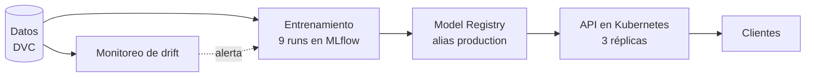

# Proyecto final MLOps: Adult Income

[](https://github.com/AcademicHumber/proyecto-final-mlops/actions/workflows/ci.yml)

Modelo de clasificación (¿gana más de 50K al año?) llevado de punta a punta: entrenamiento trazable con MLflow, imagen Docker propia, despliegue en Kubernetes con 3 réplicas, datos versionados con DVC y detección de data drift y concept drift. Trabajo individual.



## Modelo en producción

`adult-income-classifier` **versión 2** (alias `production`), run `fdded4d1e6aa4cd7b9974e1d63417f82`: GradientBoosting con F1 de 0,709 en test.

## Documentación

| Tema | Documento |
|---|---|
| **Arquitectura** (versión desplegada y su run) | [docs/arquitectura.md](docs/arquitectura.md) |
| Reparto de trabajo | [docs/reparto-trabajo.md](docs/reparto-trabajo.md) |
| Caso de negocio y CRISP-DM | [docs/crisp-dm.md](docs/crisp-dm.md) |
| Selección del modelo Champion | [docs/seleccion-modelo.md](docs/seleccion-modelo.md) |
| Etiquetas de los runs | [docs/tags.md](docs/tags.md) |
| API de inferencia | [docs/api.md](docs/api.md) |
| Servidor MLflow | [docs/mlflow-server.md](docs/mlflow-server.md) |
| Despliegue en Kubernetes y demos | [docs/despliegue.md](docs/despliegue.md), [guía en vivo](docs/guia-demo-k8s.md) |
| Datos y DVC | [docs/datos.md](docs/datos.md) |
| Detección de drift | [docs/drift.md](docs/drift.md) |
| Interfaz de priorización (extra) | [docs/ui.md](docs/ui.md) |
| Servidor MCP: predicción y consultas al dataset (extra) | [docs/mcp.md](docs/mcp.md) |
| Cumplimiento de las instrucciones | [docs/cumplimiento.md](docs/cumplimiento.md) |
| Agenda de la demo (10 min) | [docs/demo-10min.md](docs/demo-10min.md) |
| Corrección del drift (por qué reentrenar no basta) | [docs/correccion.md](docs/correccion.md) |
| Desviaciones del flujo estándar | [docs/desviaciones.md](docs/desviaciones.md) |
| Estado y cómo retomar | [docs/estado.md](docs/estado.md) |

## Estructura

| Carpeta | Contenido |
|---|---|
| `train/` | Entrenamiento, registro y reentrenamiento |
| `configs/` | Experimentos definidos en YAML |
| `serving/` | API FastAPI |
| `docker/` | Dockerfiles y dependencias de las imágenes |
| `k8s/` | Manifiestos de MLflow y de la API |
| `drift/` | Pruebas de data drift y concept drift |
| `ui/` | Interfaz Streamlit que consume la API de Kubernetes (extra) |
| `mcp_server/` | Servidor MCP (stdio) con herramientas de predicción y consulta SQL de solo lectura (extra) |
| `tests/` | 48 pruebas automáticas |
| `data/` | Datos versionados con DVC (solo los `.dvc` van en Git) |
| `entrega/` | Script que genera el ZIP de entrega |
| `.github/workflows/` | CI: pruebas con un MLflow efímero y construcción de las imágenes (ver `docs/desviaciones.md`, entrada 18) |

## Puesta en marcha

```powershell
pip install -r requirements.txt            # entorno de desarrollo
git clone <repositorio>; dvc pull           # datos (almacén local ../dvc-almacen)
minikube start
kubectl apply -f k8s/mlflow.yaml
kubectl port-forward service/mlflow 5000:5000     # en otra terminal
$env:PYTHONUTF8=1
python -m train.train                       # 9 runs
python -m train.register                    # v1 y v2, alias production
kubectl apply -f k8s/api.yaml               # API, 3 réplicas
pytest -q                                   # 48 pruebas
streamlit run ui/app.py                      # interfaz (ver docs/ui.md)
pip install -r mcp_server/requirements-mcp.txt   # servidor MCP (ver docs/mcp.md)
python entrega/crear_zip.py                 # ZIP de entrega
```

Las imágenes se construyen con `docker build` y se cargan con `minikube image load` (ver `docs/despliegue.md`). El orden y los detalles de entorno están en [docs/estado.md](docs/estado.md).
