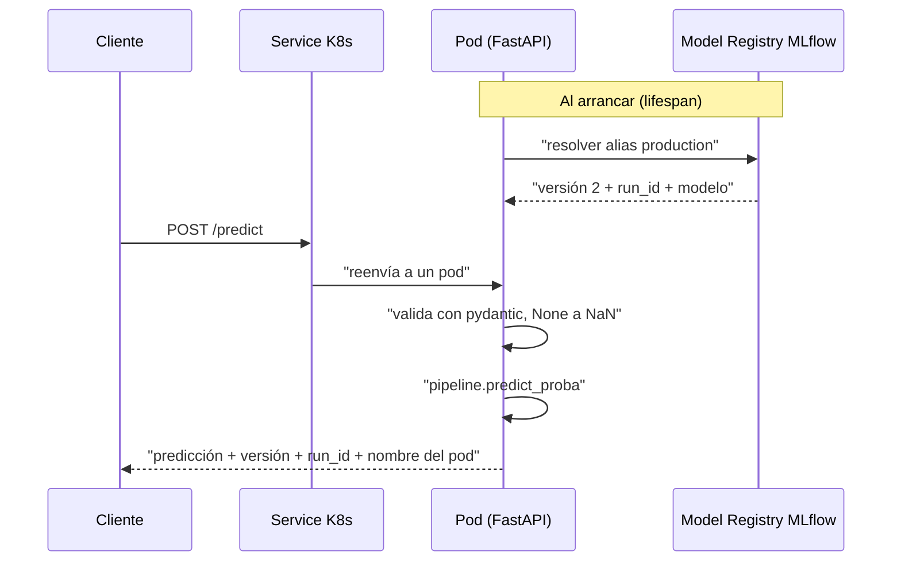

# API de inferencia

Servicio FastAPI (`serving/app.py`). Resuelve el modelo siempre por **alias** en el Model Registry de MLflow.

| Endpoint | Uso |
|---|---|
| `POST /predict` | Lista de registros (14 variables) -> predicción y probabilidad de `>50K`, versión del modelo, run y **pod** que respondió |
| `GET /health` | 200 si el modelo está cargado, 503 si no (sonda de Kubernetes) |
| `GET /info` | Modelo, versión, run_id, alias y pod |

Variables de entorno: `MLFLOW_TRACKING_URI` (defecto `sqlite:///mlflow.db`) y `MODEL_URI` (defecto `models:/adult-income-classifier@production`).

## Flujo de una petición

El campo `pod` de la respuesta permite demostrar el balanceo de carga: peticiones sucesivas al Service devuelven nombres de pod distintos.
