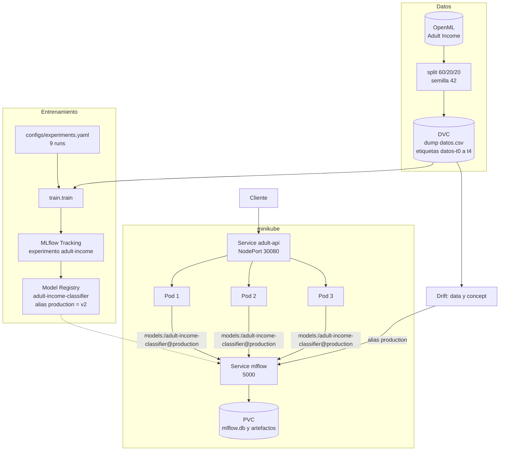
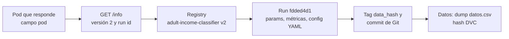

# Documento de arquitectura

Proyecto final de MLOps: llevar un modelo de clasificación (Adult Income, `>50K` / `<=50K`) desde el entrenamiento hasta un despliegue reproducible, con alta disponibilidad y detección de degradación.

## Modelo desplegado

Dato exigido por la rúbrica (apartado 3.3.2):

| | |
|---|---|
| **Nombre en el Registry** | `adult-income-classifier` |
| **Versión desplegada** | **2** (alias `production`) |
| **Run de origen** | `gb-n200-lr0.05-d5`, run id `fdded4d1e6aa4cd7b9974e1d63417f82` (experimento `adult-income`) |
| **Modelo** | GradientBoosting: 200 árboles, `learning_rate=0.05`, `max_depth=5` |
| **Métricas del run** | CV F1 0,704 · F1 test 0,709 · Precision 0,783 · Recall 0,648 · AUC 0,928 |
| **Datos** | Base del dump `data/datos.csv` (periodo 0; ver `datos.md`) |
| **Cómo se comprueba en vivo** | `GET /info` en la API devuelve versión, run id, alias y pod |

Versiones registradas:

| Versión | Run | Estado |
|---|---|---|
| 1 | `lr-C1-balanced` (`1b717ed7…`) | Modelo base (regresión logística) |
| **2** | `gb-n200-lr0.05-d5` (`fdded4d1…`) | **Champion, alias `production`, desplegada** |
| 3 | `…-v3-concept-drift` (`ea4f8cfd…`) | Descartada: primer intento de corrección |
| 4 | `…-v3-drift` (`ee3f8ffe…`) | Candidata de la corrección del concept drift; **no desplegada** porque no resuelve el problema (ver `correccion.md`) |

## Vista general

## Componentes y decisiones

| Fase | Qué hay | Dónde | Decisión clave |
|---|---|---|---|
| Modelo | 9 runs comparables, 3 familias, semilla fija, split 60/20/20 estratificado | `train/`, `configs/experiments.yaml` | La configuración vive en YAML: añadir un run no toca código. Champion por F1 en validación cruzada, no por test (`seleccion-modelo.md`) |
| MLflow | Tracking + Registry, servidor propio | `docker/Dockerfile.mlflow`, `k8s/mlflow.yaml` | Todo el ciclo pasa por MLflow; nada de pickle suelto |
| API | FastAPI: `/predict`, `/health`, `/info` | `serving/app.py`, `api.md` | Carga el modelo **por alias**, nunca por ruta. La respuesta incluye versión, run y pod |
| Docker | Dos imágenes propias con dependencias fijadas | `docker/` | La imagen de la API no contiene el modelo: lo descarga del Registry, así cambiar de versión no obliga a reconstruir |
| Kubernetes | 3 réplicas, sondas startup/readiness/liveness, Service NodePort | `k8s/`, `despliegue.md` | NodePort y no `port-forward`, porque este fija un solo pod y no deja ver el balanceo |
| Datos | Versionados con DVC | `datos.md` | Cada commit de Git apunta a datos exactos; cada run guarda el hash |
| Drift | Data drift (KS, PSI, chi-cuadrado) y concept drift (F1 por lote) | `drift/`, `drift.md` | Umbrales explícitos y justificados; pruebas en verde y rojo |
| CI | GitHub Actions: pruebas con un MLflow efímero y construcción de las dos imágenes | `.github/workflows/ci.yml` | No comprueba el hash de los datos (el almacén DVC es local; `desviaciones.md`, entrada 18) |
| Servidor MCP (extra) | Expone la predicción de la API y consultas SQL de solo lectura al dataset a un asistente | `mcp_server/`, `mcp.md` | Mismo punto de entrada que la UI (la API del clúster); el dataset va en SQLite en memoria con autorizador |
| Interfaz (extra) | Streamlit que consume la API del clúster y prioriza prospectos | `ui/`, `ui.md` | Atajos de perfiles y filas reales para la demo; muestra qué pod responde |
| Pruebas | 48 pruebas automáticas | `tests/` | Las que dependen de MLflow se omiten si no está accesible, en vez de fallar |

## Demostraciones de Kubernetes

| Exigencia | Evidencia |
|---|---|
| 3 o más réplicas `Running` | `kubectl get pods` muestra `adult-api` 3/3 (`despliegue.md`) |
| Balanceo entre pods | Campo `pod` de la respuesta: 12 peticiones repartidas 4/4/4 |
| Autorreparación | `evidencia-autorreparacion.txt`: se borra un pod, 0 errores en 30 peticiones |
| Escalado | `evidencia-escalado.txt`: 3 a 5 réplicas y vuelta, 0 errores en 50 peticiones |

Guion para repetirlas en vivo: `guia-demo-k8s.md`.

## Drift

| Tipo | Prueba | Umbral | Resultado |
|---|---|---|---|
| Data drift, numéricas | Kolmogorov-Smirnov | p < 0,01 / 12 (Bonferroni) | Limpio 0/14 (verde); derivado 5/14 (rojo) |
| Data drift, capital-gain y capital-loss | PSI | PSI ≥ 0,2 | Ídem |
| Data drift, categóricas | Chi-cuadrado | p < 0,01 / 12 | Ídem |
| Concept drift | F1 por lote | F1 < 90 % del F1 base (umbral 0,638) durante 3 lotes seguidos | Alerta en el lote 9 |

Retraso de etiquetas y limitaciones: `drift.md`.

**Qué pasa después de la alerta:** se reentrenó con tres variantes de datos y el F1 en los lotes más afectados pasó de 0,345 a como mucho 0,363, lejos del 0,71 de referencia. Reentrenar no basta con un drift que sigue creciendo, y por eso el alias `production` no se movió. Análisis y soluciones posibles en `correccion.md`.

## Trazabilidad de punta a punta

Desde una respuesta de la API se llega al run exacto, a su configuración, a los datos y al código que lo produjeron.

## Limitaciones declaradas

- **Drift sintético:** el dataset es de 1994 y no tiene drift real; los escenarios se inyectan y están diseñados para ser detectables.
- **Variables sensibles:** `sex`, `race` y `native-country` se mantienen en el modelo (justificación y limitación en `crisp-dm.md`).
- **Elección de la variante de corrección** con los mismos lotes de evaluación (`desviaciones.md`, entrada 17).
- **Clúster local:** minikube sobre Docker Desktop, un solo nodo. Las réplicas protegen de la caída de un pod, no de la caída del nodo.
- **Un solo servidor MLflow** sin réplicas: es un punto único de fallo para arrancar pods nuevos.
- **kubectl 1.32 con clúster 1.37:** fuera de la diferencia de versiones soportada; funciona.

Toda desviación del flujo estándar está en `desviaciones.md` (19 entradas). El cumplimiento punto por punto de las instrucciones está en [`cumplimiento.md`](cumplimiento.md) y la agenda de la demostración en [`demo.md`](demo.md).
