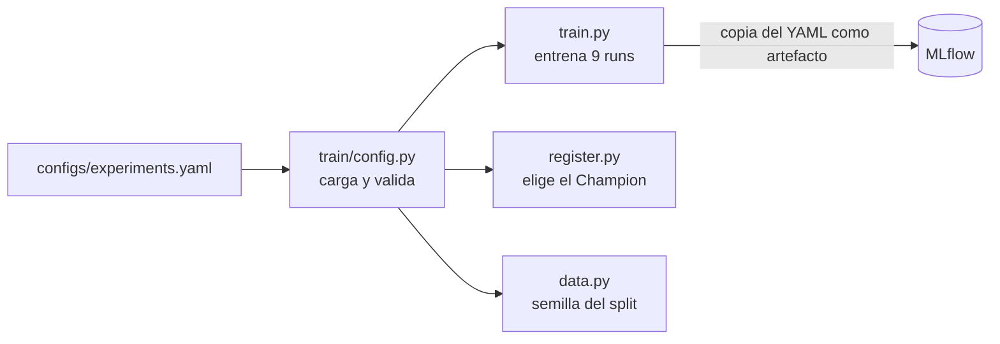

# Configuración del experimento

Qué se entrena lo define un archivo, no el código. Esto separa tres cosas:

| Qué | Dónde vive | Ejemplo |
|---|---|---|
| **Lógica** | Código (`train/`) | Cómo se entrena, se evalúa y se registra |
| **Configuración del experimento** | `configs/experiments.yaml` | Modelos, hiperparámetros, descripciones |
| **Entorno** | Variables de entorno | `MLFLOW_TRACKING_URI`, `EXPERIMENT_CONFIG` |



## Estructura del archivo

```yaml
global:
  experiment_name: adult-income
  seed: 42
  cv_folds: 5
  top_fraction: 0.10
  selection_metric: cv_f1_mean
  baseline_model: LogisticRegression

runs:
  - name: rf-n200-d20-balanced
    model: RandomForestClassifier
    family: bagging
    params: {n_estimators: 200, max_depth: 20, class_weight: balanced}
    description: >
      Misma configuración que rf-n200-d20, pero con class_weight="balanced".
```

| Sección | Campo | Qué controla |
|---|---|---|
| `global` | `seed` | Semilla del split y de los modelos (reproducibilidad) |
| `global` | `cv_folds` | Particiones de la validación cruzada |
| `global` | `top_fraction` | Fracción del ranking para `precision_top10` |
| `global` | `selection_metric` | Métrica que elige el Champion. **La leen `train.py` y `register.py`**, así no puede quedar distinta en cada sitio |
| `global` | `baseline_model` | Familia del modelo base (v1 del Registry) |
| `runs[]` | `name` | Nombre del run en MLflow |
| `runs[]` | `model` | Una clase de la lista permitida |
| `runs[]` | `family` | `linear`, `bagging` o `boosting` (tag `model_family`) |
| `runs[]` | `params` | Hiperparámetros que recibe el modelo |
| `runs[]` | `description` | Texto del campo Description del run |

## Cómo añadir un run

1. Añadir un bloque en `runs` con nombre, modelo, familia, parámetros y descripción.
2. Ejecutar `python -m train.train` (o `--only <nombre>` para uno solo).

No hay que tocar Python.

## Validación

`train/config.py` rechaza el archivo antes de entrenar si hay un error:
- falta una clave de `global` o de un run
- el `model` no está en la lista permitida
- la `family` no es válida
- hay dos runs con el mismo nombre
- no hay ningún run

La lista de modelos permitidos está en el código a propósito: el YAML elige entre opciones conocidas y no importa código arbitrario por nombre.

## Opciones de línea de comandos

| Opción | Para qué |
|---|---|
| `--only a,b` | Entrenar solo esos runs |
| `--experiment-name X` | Registrar en otro experimento (por ejemplo, para pruebas) |

La variable `EXPERIMENT_CONFIG` permite usar otro archivo YAML.

## Limitaciones

- Si se cambia el YAML después de entrenar, los runs viejos conservan su copia original como artefacto. Esa copia es la que dice con qué configuración se produjeron.
- La división 60/20/20 y la lista de variables siguen en `train/data.py`. Cambian con poca frecuencia y están documentadas allí.
