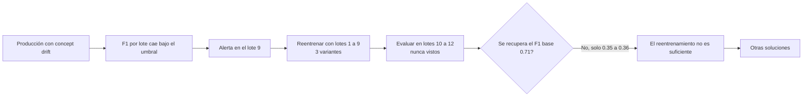
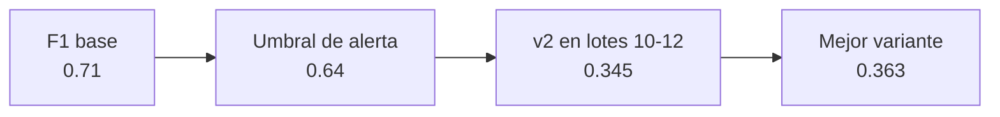

# Corrección del concept drift: qué pasa al reentrenar

Esta es la historia que se cuenta en la demo: **se detecta el drift, se reentrena, y se comprueba que reentrenar no basta.** Lo que sigue explica qué se hizo, qué salió y qué se haría después.



## Reparto de datos

| Conjunto | Contenido | Uso |
|---|---|---|
| Entrenamiento | `train.csv` y/o lotes 1 a 9 de `produccion_concept_drift.csv` | Según la variante |
| Evaluación | Lotes 10 a 12 | Medir si el modelo corregido funciona en el mundo ya cambiado |
| Referencia | `test.csv` original | Ver cuánto se olvida del comportamiento antiguo |

Los lotes 1 a 9 son los que ya están etiquetados cuando salta la alarma (lote 9). Los lotes 10 a 12 son el "futuro" respecto a ese momento, por eso sirven para evaluar sin trampa. Todo sale de `data-v2` (versionado con DVC).

## Qué se probó

El mismo modelo que está en producción (`gb-n200-lr0.05-d5`, mismos hiperparámetros), con tres formas de usar los lotes etiquetados. Solo cambian los datos. Se ejecuta con `python -m train.retrain`.

| Variante | Datos de entrenamiento | Filas |
|---|---|---|
| `pesos` | `train.csv` y lotes 1-9, con los lotes 1-9 pesando lo mismo en total que `train.csv` | 36.631 |
| `recientes` | Solo lotes 1-9 | 7.326 |
| `drift` | Solo lotes 5-9, los que ya tienen el concepto nuevo | 4.070 |

## Resultado

| Modelo | F1 en lotes 10-12 | F1 en `test.csv` original |
|---|---|---|
| v2 (producción) | 0,345 | 0,709 |
| `pesos` | 0,360 | 0,707 |
| `recientes` | 0,353 | 0,663 |
| `drift` (v4 en el Registry) | 0,363 | 0,573 |



**Conclusión: ninguna variante se acerca al F1 base (0,71) ni al umbral (0,64).** La mejor gana 0,018 sobre la v2, una diferencia que con 2.443 filas de evaluación está dentro del ruido. Y la que más gana en los lotes con drift (`drift`) es la que más olvida el mundo antiguo (0,709 baja a 0,573).

Qué quedó en MLflow:

- Experimento `adult-income-correccion`: un run por variante, con los hashes DVC de los datos, la variante y el F1 de la v2 sobre los mismos lotes.
- Model Registry: **v4** (variante `drift`, la ganadora por F1 en lotes 10-12). La **v3** quedó marcada como descartada: fue un primer intento sin pesos. El alias `production` **no se movió**: sigue en la v2.

## Por qué no basta reentrenar

1. **El drift sigue creciendo.** La intensidad del cambio sube hasta el lote 12. Un modelo entrenado con los lotes 1-9 aprende un mundo a medias: los lotes 10-12 están aún más lejos que los que vio.
2. **Hay pocos datos del mundo nuevo.** Los lotes 5-9 son 4.070 filas, y los 5-6 casi no tienen cambio todavía.
3. **El cambio es difícil de aprender, no solo de actualizar.** Quienes tienen estudios superiores dejan de ganar más de 50K y los jóvenes con jornada larga pasan a ganarlo. Es una regla nueva que el modelo debe descubrir con pocos ejemplos, mientras la clase positiva baja de 25 % a 16 %.
4. **Hay un compromiso entre olvidar y recordar.** O se mantiene el pasado (`pesos`, casi sin ganancia) o se abandona (`drift`, mejora algo pero se rompe en el mundo antiguo).

## Posibles soluciones

Son propuestas para discutir. **No se han probado en este proyecto.**

| Solución | Idea | Qué atacaría |
|---|---|---|
| Reentrenamiento periódico y automático | Reentrenar cada lote o cada pocos lotes con una ventana móvil | Que el modelo se quede atrás mientras el drift crece |
| Ponderar por antigüedad | Dar más peso a los datos recientes, de forma gradual | El compromiso entre olvidar y recordar |
| Más y mejores etiquetas | Etiquetar primero lo más incierto (aprendizaje activo) | Pocos datos del mundo nuevo |
| Mejorar el modelo | Nuevas variables (por ejemplo, estudios por jornada y edad) y buscar hiperparámetros con datos nuevos | Que la regla nueva sea difícil de capturar |
| Modelos que se adaptan | Aprendizaje en línea o ensamble que sustituye a los miembros que fallan | Un drift que no se detiene |
| Campeón y retador | Poner el candidato en sombra o canary frente al actual antes de moverlo | Desplegar algo que no mejora |
| Revisar el objetivo de negocio | Si el mundo cambió, quizá la pregunta ya no es la misma (CRISP-DM, fase 1) | Un cambio de fondo, no de datos |

## Cómo repetirlo

```powershell
kubectl port-forward service/mlflow 5000:5000     # en otra terminal
$env:PYTHONUTF8=1; $env:MLFLOW_DISABLE_AGENT_HINT=1
.venv/Scripts/python.exe -m drift.concept_drift   # muestra la alerta en el lote 9
.venv/Scripts/python.exe -m train.retrain         # 3 variantes, registra la mejor sin mover el alias
```

Cada ejecución de `train.retrain` crea una versión nueva en el Registry; el script solo la registra si supera a la v2 en los lotes 10-12.
