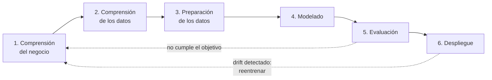

# Caso de negocio y CRISP-DM

> Escenario confirmado: entidad financiera que prioriza prospectos. Los puntos marcados con **(supuesto)** se pueden ajustar.

CRISP-DM organiza el proyecto en seis fases que se repiten en ciclo. Aquí cada fase se conecta con lo que ya construimos o falta construir.

## 1. Comprensión del negocio

**Escenario (supuesto):** una entidad financiera quiere ofrecer un producto premium (tarjeta o crédito de mayor límite) y necesita **priorizar a quién contactar** antes de gastar en la campaña.

**Pregunta de negocio:** ¿cuáles de nuestros prospectos probablemente ganan más de 50.000 USD al año?

**Qué es el modelo:** un clasificador binario que estima si el prospecto está en `>50K` o `<=50K`. Es una herramienta de priorización, no una decisión automática de aprobar o rechazar.

### Costo de los errores

| Error | Qué ocurre | Costo |
|---|---|---|
| Falso positivo | Se contacta a alguien que no califica | Se desperdicia el costo de la campaña |
| Falso negativo | No se contacta a alguien que sí calificaba | Se pierde una venta potencial |

Ninguno de los dos es despreciable, y la clase `>50K` es solo el ~24 % de los datos. Por eso la métrica principal es **F1** (equilibra precisión y recall) y no la accuracy, que daría ~76 % a un modelo que nunca encuentra a nadie.

### Criterios de éxito

- **Técnico:** F1 en test ≥ 0.65 **(supuesto)**. El modelo en producción (v2) obtiene 0.709.
- **Operativo:** servicio disponible con 3 réplicas y tolerante a fallos.
- **Sostenibilidad:** se detecta y se corrige la degradación antes de que el F1 caiga más de 10 % de forma sostenida **(supuesto, se calibra en la fase de drift)**.

### Variables sensibles: decisión tomada

El dataset incluye `sex`, `race` y `native-country`. **Decisión: se mantienen en el modelo**, porque reflejan patrones reales presentes en los datos y excluirlas simplificaría artificialmente el problema.

**Limitación declarada:** en un producto financiero real, usar estas variables para decidir a quién se ofrece un servicio puede ser discriminatorio y estar restringido legalmente. Este proyecto es un ejercicio académico con datos de 1994, y el modelo refleja las desigualdades de esa época, no las valida. En un despliegue real, esta decisión debería revisarse con el área legal y de cumplimiento.

**Consecuencia para el monitoreo:** al mantenerlas, un cambio en su distribución (por ejemplo, la proporción de `sex` o `race` en los lotes nuevos) también cuenta como data drift y se vigila igual que el resto.

## 2. Comprensión de los datos

- **Fuente:** Adult Income, censo de EE. UU. de 1994, disponible en OpenML.
- **Tamaño:** ~48.800 filas, 14 variables (6 numéricas, 8 categóricas).
- **Hallazgos relevantes:**
  - La clase objetivo está desbalanceada (~24 % `>50K`).
  - `capital-gain` y `capital-loss` valen 0 en ~90 % de las filas.
  - Hay valores faltantes en `workclass`, `occupation` y `native-country`.
- **Limitación del caso:** los datos son de 1994. Sirven para el ejercicio, no para decisiones reales actuales.

## 3. Preparación de los datos

Implementado en `train/data.py`:

- Los `?` se tratan como nulos y se imputan con la moda dentro del pipeline.
- Las numéricas se estandarizan y las categóricas se codifican con one-hot.
- Split estratificado 60 / 20 / 20 con semilla 42: train, test y producción simulada.

## 4. Modelado

Implementado en `train/train.py`. Se comparan dos familias de árboles con 6 configuraciones:

| Familia | Por qué se considera |
|---|---|
| Regresión logística | Línea base simple e interpretable |
| RandomForest | Robusto: árboles independientes que votan |
| GradientBoosting | Suele ser superior en datos tabulares: árboles en cadena que corrigen errores |

9 runs en MLflow, comparables por F1 en validación cruzada. Detalle y justificación en [`seleccion-modelo.md`](seleccion-modelo.md).

## 5. Evaluación

| Modelo | F1 | Accuracy | AUC |
|---|---|---|---|
| v1 – Regresión logística balanceada (base) | 0.677 | 0.806 | 0.907 |
| **v2 – GradientBoosting (production)** | **0.709** | **0.873** | **0.928** |

**Se elige v2** porque tiene el mejor F1 en validación cruzada (0.704), que es la métrica alineada con el costo de los errores. Se cumple el criterio técnico (≥ 0.65). Comparación completa en [`seleccion-modelo.md`](seleccion-modelo.md).

## 6. Despliegue y monitoreo

| Componente | Estado |
|---|---|
| Registro por alias `production` en MLflow | Hecho |
| API de inferencia (FastAPI) | Hecho |
| Imagen Docker | Hecho |
| Kubernetes con 3 réplicas en minikube | Hecho |
| Detección de data drift y concept drift | Hecho (ver [drift.md](drift.md)) |

El monitoreo cierra el ciclo: si hay drift, se vuelve a la fase 1 para revisar el objetivo y reentrenar.
