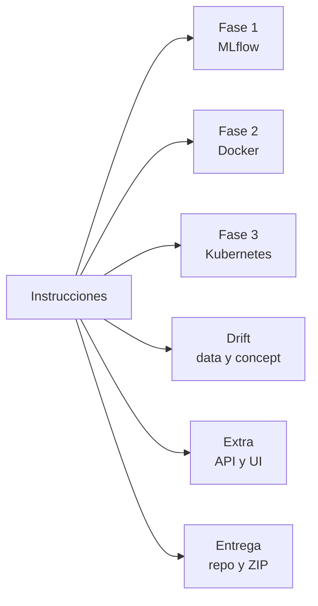

# Cumplimiento de las instrucciones

Cada requisito de `instrucciones.txt` con dónde se cumple y cómo se demuestra. Sirve para la defensa y para comprobar antes de entregar que no falta nada.

## Modalidad y entrega (secciones 2 y final)

| Requisito | Cumplimiento | Evidencia |
|---|---|---|
| Individual o grupo de hasta 3 | Trabajo individual | `reparto-trabajo.md` |
| Tabla de reparto de trabajo | Hecha, con nota sobre el uso de asistencia de IA | `reparto-trabajo.md` |
| Repositorio Git con historial revisable | Público en GitHub, con commits por pasos y etiquetas de checkpoint | https://github.com/AcademicHumber/proyecto-final-mlops, `git tag -n1` |
| Defensa individual sobre cualquier parte | Documentación y decisiones registradas | `desviaciones.md` |
| Enlace al repositorio y archivo comprimido | ZIP con documentación, código, manifiestos y evidencia del estado final | `python entrega/crear_zip.py` |

## Fase 1: modelo y MLflow (sección 3)

| Requisito | Cumplimiento | Evidencia |
|---|---|---|
| Dataset tabular con ≥1.000 registros y ≥4 variables | Adult Income: ~48.800 filas y 14 variables | `crisp-dm.md` |
| Entrenamiento reproducible (semilla, split documentado) | Semilla 42; split 60/20/20 estratificado | `train/train.py`, `train/data.py` |
| ≥5 ejecuciones con distintos hiperparámetros, comparables | 9 runs en 3 familias, con las mismas métricas | `configs/experiments.yaml`, `seleccion-modelo.md` |
| Todo el ciclo por MLflow, sin pickle/joblib "a mano" | Se guarda con `mlflow.sklearn.log_model`. El formato interno es cloudpickle por una limitación de `skops` (sigue siendo guardado vía MLflow) | `desviaciones.md`, entrada 1 |
| Modelo en el Registry con nombre estable | `adult-income-classifier` | `arquitectura.md` |
| Más de una versión registrada | v1 (base), v2 (Champion), y v3 y v4 de la corrección | `arquitectura.md` |
| Versión desplegada marcada y consumida por esa referencia | Alias `production` -> v2; la API usa `models:/adult-income-classifier@production` | `api.md`, `serving/app.py` |
| El documento de arquitectura indica versión y run desplegados | v2, run `fdded4d1e6aa4cd7b9974e1d63417f82` | `arquitectura.md` |
| Interfaz web de MLflow operativa en vivo | Servidor en el clúster, accesible con `port-forward` | `mlflow-server.md` |
| Abrir el experimento y explicar cada run | Cada run tiene descripción y 5 tags | `tags.md`, `configuracion.md` |
| Ordenar y filtrar por la métrica principal | Métrica principal `cv_f1_mean` (F1 en validación cruzada) | `seleccion-modelo.md` |
| Comparar varios runs y argumentar la elección | Tabla de resultados y respuesta corta para la defensa | `seleccion-modelo.md` |
| Mostrar en el Registry la versión en producción | v2 con alias `production` | `seleccion-modelo.md` (capturas de MLflow) |

## Fase 2: Docker (sección 4)

| Requisito | Cumplimiento | Evidencia |
|---|---|---|
| Dockerfile propio | `docker/Dockerfile.serving` (API) y `docker/Dockerfile.mlflow` (servidor) | `docker/` |
| Dependencias fijadas, incluida la versión de MLflow | `mlflow-skinny==3.17.2` en la API y `mlflow==3.17.2` en el servidor | `docker/requirements-*.txt` |
| Levanta y responde sin pasos manuales | `CMD uvicorn`; la API carga el modelo sola desde MLflow al arrancar. **Necesita que el servidor MLflow esté accesible** | `despliegue.md` |
| Probado en CI | El workflow construye las dos imágenes en cada push | `.github/workflows/ci.yml` |

## Fase 3: Kubernetes (sección 5)

| Demostración exigida | Evidencia | Cómo mostrarla |
|---|---|---|
| 3 o más réplicas `Running` a la vez | `kubectl get pods`: 3 pods `1/1` | `despliegue.md` |
| Tráfico repartido entre pods distintos | Campo `pod` de cada respuesta; 12 peticiones 4/4/4 | `k8s/probe.py`, paso 2 |
| Autorreparación | `evidencia-autorreparacion.txt`: pod borrado, 0 errores en 30 peticiones | paso 3 |
| Escalado | `evidencia-escalado.txt`: 3 a 5 réplicas y vuelta, 0 errores en 50 peticiones | paso 4 |

## Drift (sección 6)

| Requisito | Cumplimiento | Evidencia |
|---|---|---|
| **6.1** Comparar cada variable con el baseline de entrenamiento | 14 variables de cada lote contra la partición `train` de la base | `drift/data_drift.py`, `drift/monitor.py` |
| Prueba estadística por tipo de variable, justificada | KS (numéricas), PSI (capital-gain y capital-loss), chi-cuadrado (categóricas) | `drift.md` |
| Umbral explícito y de dónde sale | p < 0,01/12 (Bonferroni) y PSI ≥ 0,2 (convención) | `drift.md` |
| Rojo con datos derivados y verde con datos del mismo origen | Lotes 1-2 y 5-12: 0/14; lotes 3 y 4 (data drift): 4/14 y 5/14 | `tests/test_data_drift.py`, `tests/test_escenarios.py`, `tests/test_monitor.py` |
| **6.2** Escenario donde cambia la relación entrada-salida | Etiquetas reasignadas desde el lote 5 con intensidad creciente | `drift/inject.py` |
| Degradación sobre lotes sucesivos y gráfica temporal | F1 por lote; gráfica; el monitor guarda cada ejecución (JSON y MLflow) | `docs/img/concept_drift.png`, `drift.md` |
| Criterio de reentrenamiento (caída y lotes) | F1 < 90 % del base durante 3 lotes seguidos; alerta en el lote 9 | `drift.md` |
| Discutir el retraso de etiquetas | Sección propia, con qué hacer mientras tanto | `drift.md` |
| (Más allá) Datos versionados como una línea de tiempo | Un dump que crece con cinco etiquetas de datos (T0 a T4): en cada una el monitor da su veredicto | `datos.md`, `desviaciones.md` (20) |
| (Más allá) Qué pasa al reentrenar | Tres variantes; no bastó; soluciones posibles | `correccion.md` |

## Extra: API e interfaz (sección 7)

| Requisito | Cumplimiento | Evidencia |
|---|---|---|
| Proyecto base completo | Sí | este documento |
| UI que consuma la API real desplegada en Kubernetes | Streamlit contra el NodePort del clúster; muestra el pod que respondió | `ui.md` |
| (Fuera de la rúbrica) Servidor MCP | 8 herramientas, 3 recursos y 1 prompt: predice contra la API del clúster, consulta el dataset en solo lectura y ejecuta y consulta el monitor de drift | `mcp.md`, `tests/test_mcp.py` |

## Puntos a vigilar antes de entregar

| Punto | Estado | Qué hacer |
|---|---|---|
| Capturas de la interfaz de MLflow | **Falta**: el ZIP solo tiene texto | Tres capturas: experimento ordenado por `cv_f1_mean`, comparación de runs y Registry con la v2 en `production` |
| ZIP actualizado | Se regenera con cada cambio | `python entrega/crear_zip.py` justo antes de entregar, con MLflow y el clúster activos |
| Enlace al repositorio en la entrega | El repositorio ya existe | Pegar el enlace |
| Formato del modelo (cloudpickle) | Documentado | Tener lista la respuesta de `desviaciones.md`, entrada 1 |
| Variables sensibles en el modelo y en la UI | Documentado como limitación | Respuesta en `crisp-dm.md` |
| Reparto declarado frente al historial | Los commits llevan la línea `Co-Authored-By` de la asistencia | El texto de `reparto-trabajo.md` lo declara; mantenerlo coherente |
