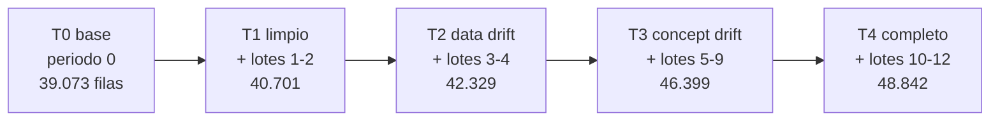
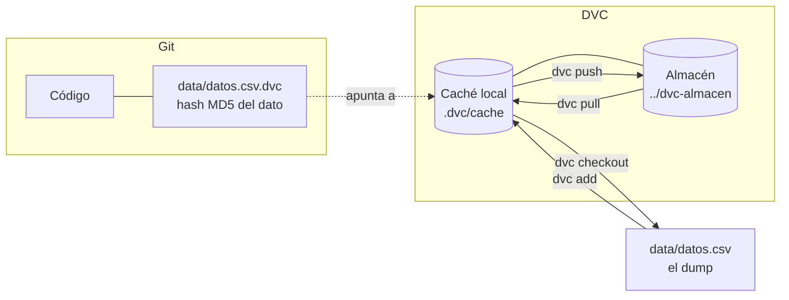

# Datos: un dump que crece y se versiona con DVC

**Problema:** Git guarda bien el código, pero no los datos (archivos grandes que cambian). Sin versionar los datos no se puede saber con qué datos se entrenó cada modelo ni qué datos tenía el monitor delante cuando saltó una alerta.

**Solución:** DVC. Git guarda un archivo pequeño (`.dvc`) con el hash del dato, y DVC guarda el dato real en otro sitio. Cada commit de Git apunta a una versión exacta de los datos.

## El modelo de datos: un dump de la base que crece

Se imagina el dataset como el **dump de una base de datos** (`data/datos.csv`). En el momento base la base y el CSV tienen lo mismo; con el tiempo la base crece, se saca otro dump que reemplaza al anterior, se vigila el drift y, si hace falta, se reentrena.

Un único archivo, 48.842 filas y 17 columnas: las 14 variables, `income` y dos de control.

| Columna | Valores | Significado |
|---|---|---|
| `periodo` | 0 a 12 | 0 = la base; 1 a 12 = lotes de llegadas, en orden temporal (~814 filas cada uno) |
| `particion` | `train`, `test`, `llegada` | En la base, a qué conjunto pertenecía cada fila (60 / 20 %); las llegadas son `llegada` |

Las filas están ordenadas por periodo, así que **cada momento del tiempo es un prefijo exacto del archivo completo**.

| Lotes | Qué tienen | Cómo se genera |
|---|---|---|
| 1-2 | Limpios, sin drift | Producción sin tocar |
| 3-4 | **Data drift**: población distinta (más mayor, otros empleos), mismas etiquetas | `inject_data_drift` aplicado al bloque de lotes 3-4 |
| 5-12 | **Concept drift** con intensidad creciente: cambia la relación entre las X y `income`, las X no cambian | `inject_concept_drift` por lote (de 1/8 en el lote 5 al máximo en el 12) |

Es **simulado**: la base (periodo 0) es Adult Income real; las llegadas salen del 20 % reservado como producción, con semillas fijas. `python -m drift.escenarios` lo genera siempre con los mismos bytes.

> **Sobre `>50K`.** La etiqueta viene del dataset (Adult Income: ¿gana más de 50K al año?). En el caso de negocio (priorizar prospectos para un producto premium) es un **indicador indirecto de capacidad de pago**, no la compra en sí. En un caso real la etiqueta sería "contrató el producto".

## Etiquetas de datos (los momentos T0 a T4)

Cada momento es una etiqueta anotada de Git. `git switch --detach <etiqueta>` y luego `dvc checkout` dejan en `data/datos.csv` exactamente ese dump. **Todas cuelgan del código final** y solo cambia `data/datos.csv.dvc`, así que en cualquiera se ejecuta el mismo monitor.

| Etiqueta | El dump contiene | Qué muestra el monitor |
|---|---|---|
| `datos-t0-base` | Periodo 0 | Nada que vigilar; el modelo v2 se entrenó con esta base |
| `datos-t1-limpio` | + lotes 1-2 | Verde: 0 variables en rojo |
| `datos-t2-data-drift` | + lotes 3-4 | Rojo: 4 y 5 variables de 14; el F1 aún aguanta |
| `datos-t3-concept-drift` | + lotes 5-9 | Cae el F1 y salta la alerta en el lote 9 |
| `datos-t4-completo` | + lotes 10-12 | Dump completo; evaluación del modelo corregido |

Las etiquetas se crean con `python -m drift.versionar_dump` (una sola vez, al final, sobre el código terminado; `--dry-run` muestra lo que haría) y se publican a mano con `git push --tags` y `dvc push`. Los hashes MD5 de `datos.csv` en cada momento son `16132510…`, `95338e30…`, `c973cd82…`, `a1d89871…` y `2b3be10b…`.

Plan B si el cambio de etiqueta falla: `python -m drift.monitor --hasta-periodo N` recorta el dump en memoria, sin cambiar de etiqueta, y da el mismo resultado (el hash del recorte coincide con el de la etiqueta).

Las etiquetas antiguas `data-v1` y `data-v2` (que versionaban `train.csv`, `test.csv`, `produccion.csv` y los dos CSV de drift por separado) **se conservan sin moverlas**: la historia pública sigue siendo reproducible. De ahí salen los datos del dump: la base es `train.csv` + `test.csv` exactamente (el modelo v2 sigue siendo válido).

En Git están `data/datos.csv.dvc`, `data/.gitignore` (generado por DVC) y `.dvc/config`. El CSV no va a Git.

## Comandos del día a día

| Qué quiero | Comando |
|---|---|
| Bajar los datos en una máquina nueva | `git clone` y luego `dvc pull` |
| Ver si los datos locales cambiaron | `dvc status` |
| Viajar a un momento | `git switch --detach datos-t2-data-drift` y `dvc checkout` |
| Volver al final | `git switch <rama>` y `dvc checkout` |
| Vigilar el drift en lo que hay en disco | `python -m drift.monitor` |
| Regenerar el dump desde cero | `python -m drift.escenarios` (o `--desde-openml`) |

`git switch` falla con cambios sin guardar, y `dvc checkout` necesita el almacén local `../dvc-almacen`.

Para subir las cinco versiones al almacén, `dvc push` en cada etiqueta. **No usar `dvc push -T`**: al leer la configuración de cada etiqueta resuelve la ruta relativa del almacén desde otro sitio y crea una carpeta `dvc-almacen` en la raíz del disco.

## Configuración

- **Almacén (remote):** carpeta local `../dvc-almacen`, hermana del repositorio. Es la opción más simple para un proyecto individual.
- **Telemetría de DVC desactivada** (`core.analytics false`).
- **Versión fijada:** `dvc==3.67.1` en `requirements.txt`.
- **Fin de línea fijo** (`\n`) al escribir el dump: los mismos bytes en Windows y Linux.

## Cómo se verifica

- `tests/test_datos.py`: el `datos.csv` local tiene el mismo MD5 que su `.dvc`.
- `tests/test_escenarios.py`: estructura del dump, cada momento es un prefijo del siguiente, semáforo de data drift por lote (lotes 1-2 y 5-9 en verde, 3-4 en rojo con ≥ 3 variables). Cuando están los CSV antiguos (`data-v2`), también comprueba que la base reproduce `train.csv` y `test.csv` fila a fila y que los lotes 1-2 y 5-12 son idénticos a los del escenario anterior.
- Regenerar el dump desde OpenML (`python -m drift.escenarios --desde-openml`) produce **exactamente los mismos bytes** que el archivo versionado (`2b3be10b…`).
- Se recorrieron las cinco etiquetas en un clon desechable con `git switch --detach` + `dvc checkout`: filas 39.073 / 40.701 / 42.329 / 46.399 / 48.842, hashes distintos, y al volver al final el archivo queda idéntico al original.

## Relación con MLflow

Cada run de entrenamiento tiene el tag `data_hash` (huella del contenido de `train`, calculada con pandas). El hash de DVC es MD5 del archivo y es **otro** valor. Los runs del reentrenamiento añaden `dvc_dump_md5` y `data_version` (`datos-t4-completo`); cada run del monitor (experimento `adult-income-drift`) guarda el periodo y el `dump_md5` analizados. Con eso se vuelve a los datos exactos con `git switch` y `dvc checkout`.

## Limitaciones

- **El almacén está en el mismo disco que el proyecto.** Protege contra borrar o cambiar el CSV por error, pero no contra perder el disco. En un proyecto real el almacén sería remoto (S3, Google Drive, Azure…) y bastaría con `dvc remote modify`.
- **El dato original sigue en OpenML.** DVC asegura que tenemos una copia exacta de lo que se usó, aunque OpenML cambiara el dataset.
- **El CSV no está en el repositorio.** Quien clone necesita acceso al almacén, o regenerarlo con `python -m drift.escenarios --desde-openml` (mismos bytes, con las versiones de pandas y scikit-learn fijadas).
- **Ya no hay escenarios paralelos.** Antes había tablas separadas de data drift y de concept drift para compararlas lado a lado; en el dump hay una sola línea de tiempo.
