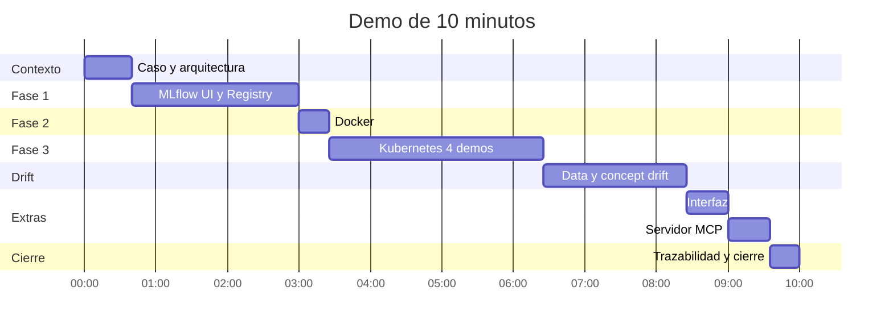

# Agenda de la demo (10 minutos)

Recorrido por todo lo desarrollado, en el orden de las instrucciones: MLflow, Docker, Kubernetes, drift y los extras (interfaz y servidor MCP). Cada bloque dice qué enseñar, qué decir y qué requisito de la rúbrica cubre (ver [cumplimiento.md](cumplimiento.md)).



| Min | Bloque | Cubre |
|---|---|---|
| 0:00 a 0:40 | Caso y arquitectura | Documento de arquitectura (3.3.2) |
| 0:40 a 3:00 | MLflow: experimento, comparación y Registry | 3.3 y 3.4 |
| 3:00 a 3:25 | Docker | Sección 4 |
| 3:25 a 6:25 | Kubernetes: las 4 demostraciones | Sección 5.2 |
| 6:25 a 8:25 | Drift: data, concept y qué pasa al reentrenar | 6.1 y 6.2 |
| 8:25 a 9:00 | Interfaz | Sección 7 |
| 9:00 a 9:35 | Servidor MCP | Extra fuera de la rúbrica |
| 9:35 a 10:00 | Trazabilidad y cierre | Defensa |

Los dos extras suman 70 s; si el tiempo aprieta, ver al final qué recortar. El MCP es el primero que se sacrifica.

## Antes de empezar (15 minutos antes)

```powershell
minikube start
kubectl wait --for=condition=Ready pod -l app=mlflow --timeout=180s
kubectl rollout status deployment/adult-api
kubectl get pods                       # mlflow 1/1 y tres adult-api 1/1
```

| Ventana | Qué lleva | Comando |
|---|---|---|
| Terminal A | Túnel a la API. **Dejar abierta** | `minikube service adult-api --url` |
| Terminal B | Túnel a MLflow. **Dejar abierta** | `kubectl port-forward service/mlflow 5000:5000` |
| Terminal C | La demo | ver abajo |
| Terminal D | Interfaz | `$env:API_URL="<URL de A>"; streamlit run ui/app.py` |
| Terminal E | Claude Code con el servidor MCP. Antes: poner la URL de A en `API_URL` de `.mcp.json`, abrir `claude` en la raíz del repositorio, aprobar el servidor `adult-income` y comprobar con `/mcp` que aparece conectado | `claude` |
| Navegador | Pestañas en este orden: MLflow (`localhost:5000`), `docs/arquitectura.md` en GitHub, la interfaz (`localhost:8501`) | |

En la terminal C, preparar las variables (el puerto de A cambia en cada ejecución):

```powershell
$U = "http://127.0.0.1:<puerto de A>"
$PY = ".venv\Scripts\python.exe"
$env:PYTHONUTF8 = "1"; $env:MLFLOW_DISABLE_AGENT_HINT = "1"
```

**Lista de comprobación** (marcar todo antes de empezar):

- [ ] `curl http://localhost:5000/health` responde y la interfaz de MLflow abre.
- [ ] `curl $U/info` devuelve versión 2 y un nombre de pod.
- [ ] La interfaz de Streamlit muestra "Conectado" en la barra lateral.
- [ ] En Claude Code, `/mcp` muestra `adult-income` conectado y una pregunta de prueba ya se respondió (calienta la sesión y confirma la API). Luego `/clear` para empezar limpio.
- [ ] `data/*.csv` existe (si no, `dvc pull`).
- [ ] La cuenta regresiva de la presentación tiene 10 minutos y se ve.

**No hacer en vivo:** `train.train` (minutos) ni `train.retrain` (varios minutos). Sus resultados ya están en MLflow y en `correccion.md`.

---

## 1. Caso y arquitectura (0:00 a 0:40)

**Enseñar:** el diagrama de `arquitectura.md` en el navegador.

**Decir:**
- "Es una entidad financiera que quiere priorizar a quién contactar para un producto premium. El modelo estima si un prospecto gana más de 50K. Se evalúa con F1 porque solo el 24 % gana eso y la accuracy engaña."
- "El énfasis es la ingeniería: MLflow, contenedor, Kubernetes con réplicas y detección de degradación."
- "Una frase de la arquitectura: el modelo vive en el Registry, la API lo carga por alias, y el alias lo consumen tres réplicas."

## 2. MLflow (0:40 a 3:00)

**Enseñar** en `localhost:5000`:

1. **Experimento `adult-income`** (0:40 a 1:05). 9 runs. "Cada run es una configuración: tres familias, con y sin `class_weight`. Cada uno tiene su descripción y 5 tags."
2. **Ordenar y filtrar** (1:05 a 1:40). Ordenar por `cv_f1_mean` descendente. Filtrar con `params.model_type = "GradientBoostingClassifier"`. "La métrica principal es el F1 en validación cruzada: elegimos sin mirar test."
3. **Comparar** (1:40 a 2:20). Seleccionar 3 runs (`gb-n200-lr0.05-d5`, `rf-n200-d20-balanced` y `lr-C1`) y pulsar *Compare*. "Gana GradientBoosting en F1, AUC y precisión del top 10 %, y es el más estable (±0,005). El balanceado sube el recall pero baja la precisión."
4. **Model Registry** (2:20 a 3:00). `adult-income-classifier`: v1 (base), **v2 con alias `production`**, v3 y v4. "La v2 es la desplegada y viene del run `fdded4d1`. Las v3 y v4 son los intentos de corregir el drift; las veremos en un momento."

**Cubre:** 3.3, 3.3.2 y 3.4.

## 3. Docker (3:00 a 3:25)

**Enseñar** (en el editor o en GitHub): `docker/Dockerfile.serving` y `docker/requirements-serving.txt`.

**Decir:**
- "Dockerfile propio, dependencias fijadas, incluida la versión de MLflow (3.17.2)."
- "La imagen no contiene el modelo: lo descarga del Registry por alias al arrancar. Cambiar de versión no obliga a reconstruir."
- "El CI construye las dos imágenes en cada push."

## 4. Kubernetes (3:25 a 6:25)

**Opcional:** en una ventana lateral, `kubectl get pods -l app=adult-api -w` para ver los pods cambiar en vivo.

```powershell
# 1. Tres réplicas Running (3:25)
kubectl get pods -l app=adult-api

# 2. Balanceo (3:50)
& $PY k8s/probe.py $U 12

# 3. Autorreparación (4:25)
$V = kubectl get pods -l app=adult-api -o jsonpath='{.items[0].metadata.name}'
kubectl delete pod $V --wait=false
& $PY k8s/probe.py $U 30
kubectl get pods -l app=adult-api

# 4. Escalado (5:25)
kubectl scale deployment/adult-api --replicas=5
kubectl rollout status deployment/adult-api
& $PY k8s/probe.py $U 25
kubectl scale deployment/adult-api --replicas=3
```

| Minuto | Demostración | Qué decir |
|---|---|---|
| 3:25 | 3 pods `1/1 Running` | "El Deployment pide 3 réplicas y hay 3 corriendo a la vez." |
| 3:50 | Balanceo | "Cada respuesta incluye el nombre del pod. Doce peticiones, cero errores, repartidas entre tres pods." |
| 4:25 | Autorreparación | "Borro un pod mientras envío 30 peticiones. Kubernetes crea otro y el Service solo envía tráfico a pods listos, por eso hay cero errores." |
| 5:25 | Escalado | "Un comando sube a 5 réplicas, el Service las incorpora cuando están listas y vuelvo a 3." |

**Si el reparto no sale parejo:** "el túnel de minikube balancea por conexión, no por petición; con más volumen se iguala" (está en `despliegue.md`).

**Cubre:** las cuatro demostraciones de 5.2. Evidencia de respaldo: `evidencia-autorreparacion.txt` y `evidencia-escalado.txt`.

## 5. Drift (6:25 a 8:25)

**Data drift y concept drift con pruebas en verde y rojo** (6:25 a 7:05):

```powershell
& $PY -m pytest tests/test_data_drift.py tests/test_concept_drift.py -v -k "verde or rojo"
```

Salen 4 pruebas en unos 3 segundos. **Decir:** "Datos del mismo origen dan verde y datos derivados dan rojo, tanto para data drift como para concept drift."

**Data drift** (7:05 a 7:35). Mostrar la tabla de `drift.md` (o ejecutar `& $PY -m drift.data_drift`). **Decir:**
- "Una prueba por tipo de variable: KS para numéricas, PSI para capital-gain y capital-loss, que son 90 % ceros, y chi-cuadrado para categóricas."
- "Umbral p < 0,01 dividido entre 12 pruebas (Bonferroni) y PSI ≥ 0,2, que es la convención. Limpio: 0 de 14 variables. Con drift: 5 de 14."

**Concept drift** (7:35 a 8:25). Abrir `docs/img/concept_drift.png`. **Decir:**
- "El F1 por lote cae a partir del lote 5. El criterio es: F1 por debajo del 90 % del base, durante tres lotes seguidos. Salta la alerta en el lote 9."
- "Retraso de etiquetas: en el mundo real la etiqueta tarda meses. Por eso el data drift es la señal temprana y el F1 la confirmación; mientras tanto se evaluaría con una muestra etiquetada de forma prioritaria o con proxies como la conversión de la campaña."
- "Reentrené con tres variantes de datos (experimento `adult-income-correccion`, v3 y v4 del Registry) y el F1 sube de 0,345 a 0,363 como máximo, lejos del 0,71. Reentrenar no basta: el drift sigue creciendo. En `correccion.md` están las soluciones: reentrenar de forma periódica, ponderar por antigüedad, más etiquetas, mejores variables y despliegue campeón/retador. Por eso el alias sigue en la v2."

**Cubre:** 6.1 y 6.2.

## 6. Interfaz (8:25 a 9:00)

**Enseñar** la interfaz en `localhost:8501`:

1. Barra lateral: "Conectado, modelo v2, run `fdded4d1`." (5 s)
2. Pestaña *Un prospecto*: clic en **Ejecutivo** y *Evaluar* (86 %, prioridad Alta). "Atajos para rellenar al instante; hay también filas reales al azar." (15 s)
3. Pestaña *Campaña*: *Armar muestra* y *Puntuar campaña*. "Contacto al mejor 10 % y de ese grupo casi todos ganan de verdad más de 50K (en la prueba salió un 98 %; con otra muestra varía un poco)." (10 s)
4. Barra lateral: "Aquí se ve qué pod respondió: es la API del clúster, no un proceso local." (5 s)

**Cubre:** sección 7 (extra).

## 7. Servidor MCP (9:00 a 9:35)

**Enseñar** en la terminal E (Claude Code con `adult-income` conectado). Dos preguntas, escritas o pegadas de antemano:

1. "¿Qué proporción gana más de 50K por nivel educativo en `test`? Muéstrame los 4 niveles más altos." (15 s) Llama a `consultar_datos` y devuelve Prof-school, Doctorate, Masters y Bachelors (75, 71, 58 y 40 %).
2. "Evalúa a un ejecutivo de 45 años con maestría que trabaja 50 horas." (15 s) Llama a `predecir_prospecto` y responde 86 %, prioridad Alta, versión 2 y el nombre del pod.

**Decir:**
- "Es un servidor MCP que expone la API de Kubernetes y el dataset a un asistente. La predicción no se calcula en local: pasa por el clúster, por eso devuelve el pod y la versión."
- "El SQL es de solo lectura, con un autorizador de SQLite que bloquea todo lo que no sea SELECT. Está fuera de la rúbrica; es un extra."

**Si Claude tarda o la API no responde:** no esperar. Decir "lo dejo probado" y mostrar `& $PY -m pytest tests/test_mcp.py -q` (16 pruebas en unos 2 s, incluida una extremo a extremo con el cliente MCP) o `docs/mcp.md`.

**Cubre:** nada de la rúbrica. Detalle en [mcp.md](mcp.md).

## 8. Trazabilidad y cierre (9:35 a 10:00)

```powershell
curl $U/info
```

**Decir:** "De una respuesta de la API llego al pod, a la versión 2, al run `fdded4d1`, a su configuración y a los datos versionados con DVC. Todo está en el repositorio con CI, y cada desviación del flujo estándar está registrada en `desviaciones.md` (19 entradas)."

---

## Si falta tiempo: qué recortar (en este orden)

1. Servidor MCP: dejar solo la pregunta de la predicción, o saltarlo y mencionarlo en el cierre (ahorra 20 a 35 s).
2. Interfaz: dejar solo el perfil Ejecutivo y omitir la pestaña *Campaña* (ahorra 15 s).
3. Docker: pasar a una sola frase (ahorra 10 s).
4. Data drift: no ejecutar nada, mostrar solo el resultado 0/14 contra 5/14 (ahorra 20 s).
5. MLflow: no filtrar, solo ordenar (ahorra 30 s).

**No recortar:** las 4 demostraciones de Kubernetes ni el criterio y el retraso de etiquetas del concept drift, que son requisitos explícitos.

## Si algo falla

| Síntoma | Qué hacer |
|---|---|
| La interfaz de MLflow no abre | Reabrir la terminal B (`kubectl port-forward service/mlflow 5000:5000`) |
| `probe.py` da errores | La URL de A cambió o A se cerró; reabrirla y actualizar `$U` |
| Un pod tarda en estar `1/1` | Es normal hasta 2 minutos; mientras, seguir con el drift y volver |
| El clúster no responde | Enseñar las salidas guardadas: `evidencia-autorreparacion.txt`, `evidencia-escalado.txt`, y `estado-final.txt` del ZIP |
| La interfaz dice "Sin conexión" | Revisar la URL en la barra lateral (la de A) |
| Claude Code no ve el servidor MCP | `/mcp` para ver el estado; revisar que `API_URL` de `.mcp.json` sea la de A y reiniciar `claude` |
| Las herramientas de predicción dan error pero las de datos funcionan | La URL de A cambió o el túnel se cerró; actualizar `.mcp.json` y reiniciar `claude` |

## Preguntas probables de la defensa

| Pregunta | Respuesta corta |
|---|---|
| ¿Por qué F1 y no accuracy? | Solo el 24 % gana más de 50K; un modelo que siempre dice "no" tendría 76 % de accuracy (`seleccion-modelo.md`). |
| ¿Por qué elegir con validación cruzada y no con test? | Para no sesgar test; test sólo reporta y confirmó el resultado (CV 0,704, test 0,709). |
| ¿Por qué cloudpickle? ¿No estaba prohibido el pickle? | Se guarda con `mlflow.sklearn.log_model`; cloudpickle es el formato interno porque `skops` bloquea los árboles de scikit-learn. Riesgo asumido porque el modelo es nuestro y se carga solo de nuestro registro (`desviaciones.md`, entrada 1). |
| ¿Cómo sabe la API qué versión servir? | Por el alias `production` del Registry; `GET /info` devuelve versión y run. |
| ¿Qué pasa si cae un pod? | Kubernetes crea otro; el Service solo envía tráfico a pods listos. |
| ¿Y si cae el nodo o MLflow? | No hay protección: minikube es de un solo nodo y MLflow no está replicado. Está declarado en las limitaciones de `arquitectura.md`. |
| ¿Por qué esas pruebas de drift? | KS para numéricas, PSI para variables casi todo ceros, chi-cuadrado para categóricas; umbral de Bonferroni por las 12 pruebas (`drift.md`). |
| ¿De dónde sale el criterio de reentrenamiento? | 10 % de caída del F1 viene del criterio de éxito de `crisp-dm.md`; 3 lotes seguidos para no reaccionar al ruido (±0,03). |
| ¿Por qué no se movió el alias después de reentrenar? | Porque la mejora (0,345 a 0,363) no justifica el cambio y la v4 pierde mucho en los datos antiguos (`correccion.md`). |
| ¿Es drift real? | No, es inyectado; el dataset es de 1994 y no tiene drift real. Está declarado en las limitaciones. |
| ¿Las variables sensibles? | Se mantienen y se declara la limitación; en un producto real habría que revisarlas con el área legal (`crisp-dm.md`). |
| ¿Para qué sirve el servidor MCP? ¿Es seguro? | Deja que un asistente prediga contra el clúster y consulte el dataset. Solo lectura (autorizador de SQLite), máximo 200 filas, `API_URL` fija en el entorno. Es un extra y los datos son públicos de 1994 (`mcp.md`). |
| ¿Por qué SQLite y no DuckDB? | Sin dependencia nueva y con un sandbox estricto; para 50.000 filas basta. Se pierde la mediana y los percentiles (`desviaciones.md`, entrada 19). |
| ¿Qué parte hizo la IA? | Hubo asistencia de Claude Code; las decisiones las tomó el autor y están registradas (`reparto-trabajo.md`). |
