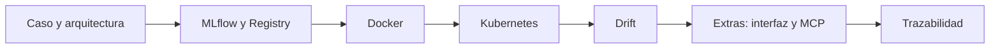

# Guía de la demostración

Recorrido por el proyecto en el orden de las instrucciones: MLflow, Docker, Kubernetes, deriva de datos y de concepto (viajando por las etiquetas de datos), y dos extras (interfaz y servidor MCP). Cada bloque indica qué se muestra y qué requisito cubre; la correspondencia completa está en [cumplimiento.md](cumplimiento.md).



| Bloque | Qué se muestra | Cubre |
|---|---|---|
| Caso y arquitectura | El caso de negocio y el diagrama de [arquitectura.md](arquitectura.md) | Documento de arquitectura (3.3.2) |
| MLflow | Experimento con 9 runs, orden y filtro por `cv_f1_mean`, comparación de runs y Model Registry con la versión en `production` | 3.3 y 3.4 |
| Docker | `Dockerfile.serving` con dependencias fijadas | Sección 4 |
| Kubernetes | Réplicas, balanceo, autorreparación y escalado | Sección 5.2 |
| Drift | Viaje por las etiquetas de datos con el monitor en verde y rojo, criterio de reentrenamiento, retraso de etiquetas y qué pasa al reentrenar | 6.1 y 6.2 |
| Interfaz | Aplicación Streamlit sobre la API del clúster | Sección 7 (extra) |
| Servidor MCP | Un asistente predice, consulta el dataset y ejecuta el monitor de drift | Extra fuera de la rúbrica |
| Trazabilidad | De una respuesta de la API al pod, la versión, el run y los datos | Cierre |

## Requisitos previos

Clúster de minikube con MLflow y las tres réplicas de la API en `Running`, más los datos de `data/` (`dvc pull`). Para reproducir el recorrido:

| Ventana | Qué hace | Comando |
|---|---|---|
| A | Túnel a la API (queda abierta) | `minikube service adult-api --url` |
| B | Túnel a MLflow (queda abierta) | `kubectl port-forward service/mlflow 5000:5000` |
| C | Comandos de la demo | ver las secciones |
| D | Interfaz | `API_URL=<URL de A> streamlit run ui/app.py` |
| E | Servidor MCP desde Claude Code | `claude`, con `API_URL` apuntando a la URL de A en `.mcp.json` |

El puerto del túnel de la API cambia en cada ejecución. El entrenamiento (`train.train`) y la corrección (`train.retrain`) son largos y no se ejecutan en la demostración; sus resultados están en MLflow y en [correccion.md](correccion.md).

## 1. Caso y arquitectura

Una entidad financiera quiere priorizar a quién contactar para un producto premium. El modelo estima si un prospecto gana más de 50K. Se evalúa con F1 porque solo el 24 % de las personas supera ese umbral y la accuracy engaña. El modelo vive en el Model Registry, la API lo carga por alias y tres réplicas lo sirven. Ver [crisp-dm.md](crisp-dm.md) y [arquitectura.md](arquitectura.md).

## 2. MLflow

En `localhost:5000`:

1. **Experimento `adult-income`**: 9 runs en tres familias de modelos, con y sin `class_weight`; cada run tiene descripción y 5 tags.
2. **Ordenar y filtrar** por la métrica principal, `cv_f1_mean`, y por `params.model_type`. La elección se hace con validación cruzada, sin mirar la prueba reservada.
3. **Comparar** `gb-n200-lr0.05-d5`, `rf-n200-d20-balanced` y `lr-C1`. Gana GradientBoosting en F1, AUC y precisión del 10 % superior, y es el más estable.
4. **Model Registry**: `adult-income-classifier` con v1 (base), v2 con el alias `production` (la desplegada, del run `fdded4d1`) y v5 (el mejor intento de corregir el drift, sin promover; la v3 y la v4 son obsoletas). El experimento `adult-income-drift` guarda cada ejecución del monitor.

Más detalle en [seleccion-modelo.md](seleccion-modelo.md) y [tags.md](tags.md).

## 3. Docker

`docker/Dockerfile.serving` y `docker/requirements-serving.txt`: Dockerfile propio con las dependencias fijadas, incluida la versión de MLflow. La imagen no contiene el modelo: lo descarga del Registry por alias al arrancar, así que cambiar de versión no obliga a reconstruirla. El CI construye las dos imágenes en cada push. Ver [despliegue.md](despliegue.md).

## 4. Kubernetes

```powershell
kubectl get pods -l app=adult-api                       # 1. tres réplicas Running
python k8s/probe.py $U 12                               # 2. balanceo
kubectl delete pod <uno> --wait=false                   # 3. autorreparación
python k8s/probe.py $U 30
kubectl scale deployment/adult-api --replicas=5         # 4. escalado
python k8s/probe.py $U 25
kubectl scale deployment/adult-api --replicas=3
```

| Demostración | Qué ocurre |
|---|---|
| Réplicas | El Deployment pide 3 y hay 3 pods `1/1 Running` a la vez |
| Balanceo | Cada respuesta incluye el nombre del pod; 12 peticiones sin errores repartidas entre los tres |
| Autorreparación | Con un pod borrado y 30 peticiones en curso, Kubernetes crea otro y el Service solo envía tráfico a pods listos: 0 errores |
| Escalado | Un comando sube a 5 réplicas, que el Service incorpora al estar listas, y se vuelve a 3 |

El túnel de minikube balancea por conexión, no por petición, por lo que con pocas peticiones el reparto puede no ser parejo (ver [despliegue.md](despliegue.md)). Evidencia guardada: `evidencia-autorreparacion.txt` y `evidencia-escalado.txt`. Guía completa: [guia-demo-k8s.md](guia-demo-k8s.md).

## 5. Drift

Los datos son un **dump que crece** (`data/datos.csv`) con cinco etiquetas de Git, una por momento ([datos.md](datos.md)). En cada una se ejecuta el mismo monitor:

```powershell
git switch --detach datos-t1-limpio         # 1. etiqueta de datos
dvc checkout                                # 2. deja en data/ el dump de ese momento
python -m drift.monitor                     # 3. variables en rojo y F1 por lote, veredicto
```

| Etiqueta | El dump contiene | Qué muestra el monitor |
|---|---|---|
| `datos-t0-base` | Periodo 0 (la base) | Nada que vigilar; el modelo v2 se entrenó con ella |
| `datos-t1-limpio` | + lotes 1-2 | **Verde**: 0 de 14 variables en rojo |
| `datos-t2-data-drift` | + lotes 3-4 | **Rojo**: 4 y 5 de 14 variables; el F1 aún aguanta |
| `datos-t3-concept-drift` | + lotes 5-9 | Cae el F1 y **salta la alerta en el lote 9** |
| `datos-t4-completo` | + lotes 10-12 | Dump completo; evaluación del modelo corregido |

Se vuelve al final con `git switch <rama>` y `dvc checkout`. Si el cambio de etiqueta falla, `python -m drift.monitor --hasta-periodo 4` da el mismo resultado sin cambiar de etiqueta.

- **Data drift**: una prueba por tipo de variable (KS en numéricas, PSI en `capital-gain` y `capital-loss`, chi-cuadrado en categóricas), con umbral p < 0,01 dividido entre 12 pruebas (Bonferroni) y PSI ≥ 0,2.
- **Concept drift**: el F1 por lote cae desde el lote 5. El criterio de reentrenamiento es un F1 por debajo del 90 % del base durante tres lotes seguidos. Gráfica en `docs/img/concept_drift.png`.
- **Resultados guardados**: cada ejecución del monitor queda en `resultados/drift/` y como un run del experimento `adult-income-drift` de MLflow.
- **Retraso de etiquetas**: en la práctica la etiqueta tarda meses, así que el data drift actúa como señal temprana y el F1 como confirmación; mientras tanto se puede evaluar con una muestra etiquetada de forma prioritaria o con indicadores indirectos.
- **Reentrenar no basta**: tres variantes (experimento `adult-income-correccion`, versión 5 del Registry) suben el F1 de 0,345 a 0,363 como máximo, lejos del 0,71 de referencia. Por eso el alias sigue en la v2. Las soluciones posibles están en [correccion.md](correccion.md).

Pruebas en verde y rojo: `python -m pytest tests/test_data_drift.py tests/test_monitor.py -v`. Detalle en [drift.md](drift.md). El drift es inyectado: el dataset es de 1994 y no tiene deriva real.

## 6. Interfaz (extra)

Aplicación Streamlit en `localhost:8501` que consume la API del clúster, no un proceso local. Muestra el modelo y el run desplegados, ofrece atajos de perfiles para rellenar el formulario, evalúa un prospecto o una campaña completa (contactando al 10 % mejor puntuado) e indica qué pod respondió cada consulta. Ver [ui.md](ui.md).

## 7. Servidor MCP (extra)

Desde Claude Code con el servidor `adult-income` conectado, tres preguntas de ejemplo:

1. *¿Qué proporción gana más de 50K por nivel educativo en `test`?* Usa `consultar_datos`.
2. *Evalúa a un ejecutivo de 45 años con maestría que trabaja 50 horas.* Usa `predecir_prospecto` y devuelve la probabilidad, la prioridad, la versión del modelo y el pod que respondió.
3. *¿Cuál es el último resultado de drift? Ejecútalo hasta el periodo 4.* Usa `ultimo_resultado_drift` y `ejecutar_drift` (esta es la única que escribe).

La predicción no se calcula en local: pasa por la API del clúster. Las consultas al dataset son de solo lectura. Si el asistente no está disponible, `python -m pytest tests/test_mcp.py` ejecuta las 17 pruebas del servidor, incluida una de extremo a extremo. Ver [mcp.md](mcp.md).

## 8. Trazabilidad

```powershell
curl $U/info
```

De una respuesta de la API se llega al pod, a la versión 2, al run `fdded4d1`, a su configuración y a los datos versionados con DVC; y de una alerta de drift, al periodo y al hash del dump con el que se calculó. Todo está en el repositorio con integración continua, y cada desviación del flujo estándar está registrada en [desviaciones.md](desviaciones.md).
