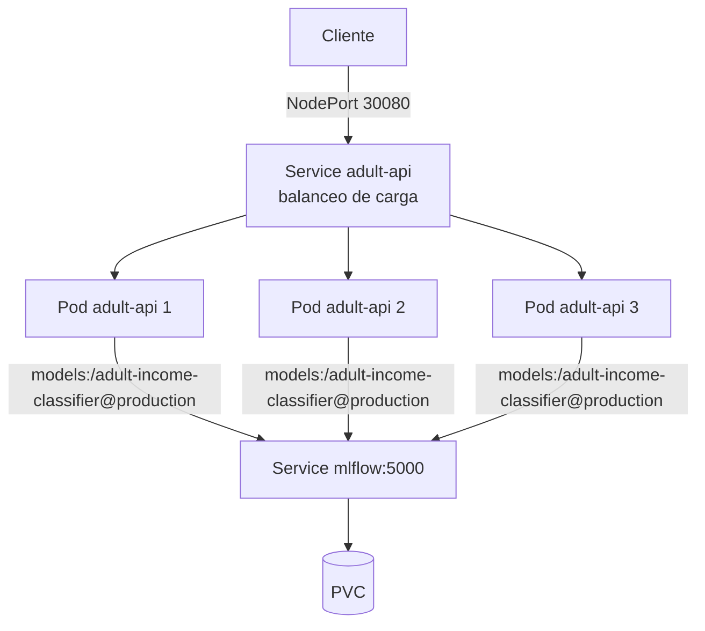

# Despliegue en Kubernetes

| Archivo | Qué es |
|---|---|
| `docker/Dockerfile.serving` | Imagen propia de la API (no contiene el modelo: lo descarga por alias) |
| `docker/requirements-serving.txt` | Dependencias con versión fijada (`mlflow-skinny==3.17.2`, scikit-learn, etc.) |
| `k8s/api.yaml` | Deployment con 3 réplicas, sondas de salud y Service NodePort |

## Sondas de salud
- `startupProbe`: da hasta 2 minutos para cargar el modelo. Si MLflow no estaba listo, el arranque falla y Kubernetes reinicia el contenedor para reintentar.
- `readinessProbe`: un pod solo recibe tráfico cuando `/health` responde 200.
- `livenessProbe`: reinicia el pod si deja de responder.

## Orden de despliegue
1. MLflow (`k8s/mlflow.yaml`).
2. Entrenar y registrar el modelo (el alias `production` debe existir).
3. API (`k8s/api.yaml`).

## Evidencia hasta ahora
- 3 pods `Running` en simultáneo.
- Balanceo comprobado: 12 peticiones a `/predict` → 4 por cada pod.
- Respuesta de `/info`: `adult-income-classifier`, alias `production`, versión 2, run `6741673bd7ab49dab81e82c5b696df9a`.

## Demostraciones

Para repetirlas en vivo, ver la [guía rápida](guia-demo-k8s.md).

Las peticiones se envían con `k8s/probe.py`, que hace N llamadas a `/predict` y cuenta qué pod respondió (campo `pod`). Salida completa de terminal en los archivos de evidencia.

### Autorreparación ([evidencia](evidencia-autorreparacion.txt))

Se borra un pod (`kubectl delete pod`) mientras se envían 30 peticiones.

- El `Deployment` crea de inmediato un pod nuevo (`z7gfx`) y el borrado queda en `Terminating`.
- **0 errores** en las 30 peticiones: el Service deja de enviar tráfico al pod que se elimina y los otros dos atienden (13 y 17).
- A los pocos segundos hay otra vez 3 pods `1/1 Running`, y el pod nuevo ya recibe tráfico (14 de 30). Carga el modelo por alias desde MLflow, igual que los demás.

### Escalado ([evidencia](evidencia-escalado.txt))

`kubectl scale deployment/adult-api --replicas=5`, luego de vuelta a 3.

- En unos 20 s hay 5 pods `1/1 Running`.
- 50 peticiones, 0 errores, repartidas entre los 5 pods (7, 8, 10, 12 y 13).
- Al volver a 3 réplicas se eliminan los dos pods sobrantes y el servicio sigue sin errores.

**Matiz sobre el reparto:** `minikube service` con el driver Docker en Windows abre un túnel local, y el reparto resulta algo desigual con pocas peticiones. Kubernetes balancea por conexión, no por petición, así que con pocas llamadas no sale exactamente 4/4/4. Con 12 peticiones en la primera verificación sí salió parejo; con más volumen la distribución tiende a igualarse.
