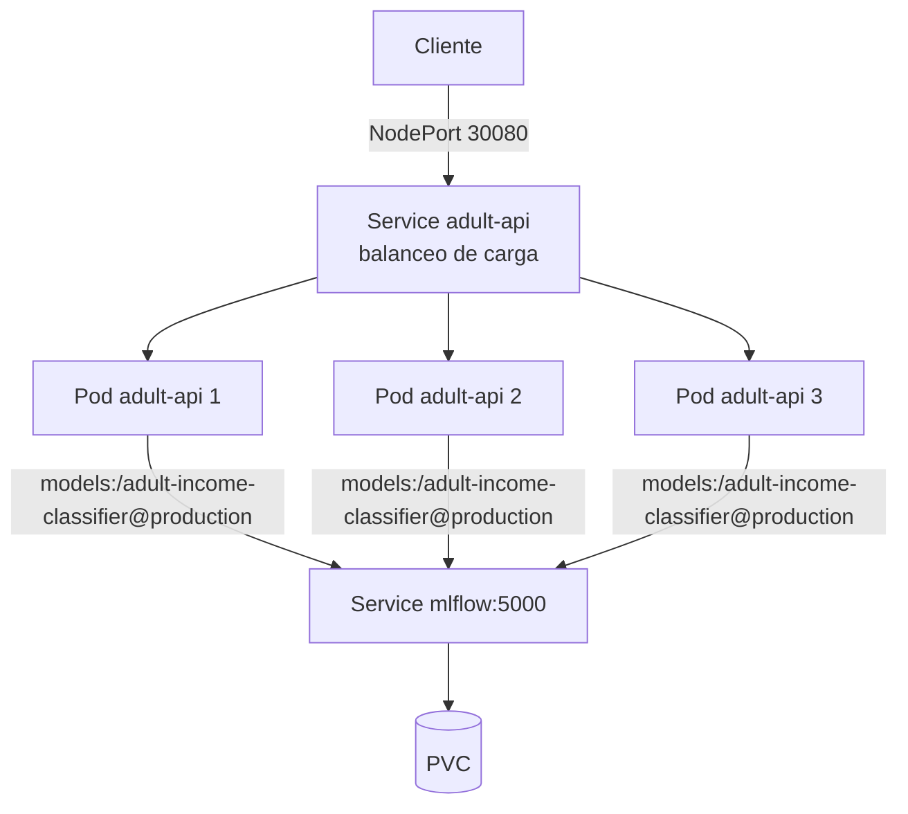

# Despliegue en Kubernetes

| Archivo | Qué es |
|---|---|
| `docker/Dockerfile.serving` | Imagen propia de la API (no contiene el modelo: lo descarga por alias) |
| `docker/requirements-serving.txt` | Dependencias con versión fijada (`mlflow-skinny==3.17.2`, scikit-learn, etc.) |
| `k8s/api.yaml` | Deployment con 3 réplicas, sondas de salud y Service NodePort |

## Sondas de salud
- `startupProbe`: da hasta 2 minutos para cargar el modelo. Si MLflow no estaba listo, el arranque falla y Kubernetes reinicia el contenedor para reintentar.
- `readinessProbe`: un pod solo recibe tráfico cuando `/health` responde 200.
- `livenessProbe`: reinicia el pod si deja de responder.

## Orden de despliegue
1. MLflow (`k8s/mlflow.yaml`).
2. Entrenar y registrar el modelo (el alias `production` debe existir).
3. API (`k8s/api.yaml`).

## Evidencia hasta ahora
- 3 pods `Running` en simultáneo.
- Balanceo comprobado: 12 peticiones a `/predict` → 4 por cada pod.
- Respuesta de `/info`: `adult-income-classifier`, alias `production`, versión 2, run `6741673bd7ab49dab81e82c5b696df9a`.

Pendientes de documentar con captura: autorreparación (borrar un pod) y escalado (`kubectl scale`).
