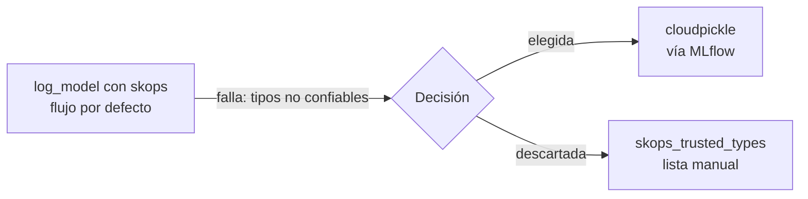

# Desviaciones del flujo estándar y decisiones técnicas

Este documento registra cada punto donde el proyecto se aparta del flujo habitual de una herramienta (MLflow, Docker, Kubernetes, etc.), con el motivo y su impacto. Se actualiza a medida que avanza el proyecto.

## Resumen

| # | Área | Flujo habitual | Lo que hacemos | Motivo |
|---|---|---|---|---|
| 1 | MLflow | Serialización del modelo con `skops` (por defecto en MLflow 3.x) | `serialization_format="cloudpickle"` | `skops` bloquea los árboles de scikit-learn por considerarlos tipos no confiables |
| 2 | MLflow | Backend de archivos local (`./mlruns`) | SQLite (`sqlite:///mlflow.db`) | El Model Registry con alias requiere un backend de base de datos |
| 3 | Datos | Versionar el dataset en el repositorio | Versionado con DVC: Git guarda solo los archivos `.dvc` y los CSV van a un almacén aparte | Ver entrada 3 (revisada, antes se ignoraban sin versionar) |
| 4 | Métricas | Accuracy como métrica principal | F1 como métrica principal | La clase `>50K` es solo ~24 % de los datos; la accuracy engaña |
| 5 | Serving | Cargar con `mlflow.pyfunc` | `mlflow.sklearn.load_model` por alias | `pyfunc` solo expone `predict`; necesitamos `predict_proba` |
| 6 | Serving | Enviar `None` tal cual al pipeline | Convertir `None` a `np.nan` antes de predecir | El `SimpleImputer` solo reconoce `np.nan` como valor faltante |
| 7 | Serving | Importar el esquema desde `train/` | Lista de variables duplicada en `serving/app.py` | La imagen de serving no debe depender del código de entrenamiento |
| 8 | Selección | Elegir el modelo con la métrica del conjunto de test | Elegir por F1 medio en validación cruzada (solo train); test solo reporta | Si test participa en la decisión, su resultado queda optimista |
| 9 | Entrenamiento | Reentrenar añadiendo versiones al Registry existente | Borrar `mlflow.db` y reentrenar de cero al ampliar a 9 runs | Mantener un Registry limpio (v1 = base, v2 = Champion) sin versiones obsoletas |
| 10 | MLflow | Usar `sqlite:///mlflow.db` directo y artefactos en disco local | Servidor `mlflow server --serve-artifacts`; clientes por `http://localhost:5000` | La BD guardaba rutas absolutas de Windows (`F:/...`) que no existen en un contenedor Linux |
| 11 | Entorno | Salida por consola estándar | `PYTHONUTF8=1` al ejecutar contra el servidor | Con servidor remoto MLflow imprime un emoji que la consola cp1252 de Windows no puede codificar |
| 12 | Kubernetes | Construir imágenes con `minikube docker-env` | `docker build` en Docker Desktop + `minikube image load` | Este minikube usa el runtime containerd; `docker-env` falla en Windows (`SSH_AGENT_START`) |
| 13 | MLflow | Valores por defecto del servidor (4 workers) | `--workers 1`, límite de memoria 2.5 GiB y `--allowed-hosts` explícito | 4 workers y 1 GiB / 1.5 GiB acabaron en `OOMKilled`; la validación de Host de MLflow rechaza nombres del Service |
| 14 | Kubernetes | Exponer con `port-forward` | `Service` NodePort + `minikube service --url` | `port-forward` fija una sola réplica y no permite demostrar el balanceo |
| 15 | Entrenamiento | Cambiar la configuración del código y reentrenar | Descripción, copia del YAML y retirada del tag `dataset` se aplicaron a los 9 runs existentes con `set_tag` / `log_artifact` | Eran textos y archivos constantes; reentrenar daba el mismo resultado. Se verificó run por run contra `run_tags()` |
| 16 | Drift | Probar con datos reales de producción | Drift inyectado y pruebas con MLflow que se omiten si no está accesible | El dataset de 1994 no tiene drift real; las pruebas de lógica siempre corren |
| 17 | Corrección | Elegir la variante con un conjunto separado de la evaluación | Elegida con los mismos lotes 10-12 con los que se informa | No había otro conjunto con el concepto nuevo; v3 se dejó como descartada |
| 18 | CI | Comprobar el hash de los datos contra DVC | Esa prueba se excluye en GitHub Actions | El almacén DVC es local; el dump regenerado en CI no está garantizado byte a byte |
| 19 | Extra MCP | Servidor MCP con el SDK 1.x y DuckDB (opción inicial) | `mcp` 2.3.0 (la última) y SQLite de la biblioteca estándar | Sin conflictos de dependencias; SQLite no añade dependencia y su autorizador permite un sandbox estricto |
| 20 | Datos | Un CSV por conjunto (train, test, producción y dos de drift) | Un dump temporal `data/datos.csv` que crece (periodos 0 a 12) con cinco etiquetas de datos T0 a T4 | Los datos cambian con el tiempo; un solo archivo versionado representa una base de datos real y evita escenarios paralelos |

## Detalle

### 1. Serialización con cloudpickle en lugar de skops

**Qué pasó:** al llamar a `mlflow.sklearn.log_model`, MLflow 3.17 intentó guardar con `skops` y falló con:

```
The saved sklearn model references untrusted types ... ['numpy.dtype', 'sklearn.tree._tree.Tree']
```

**Por qué:** `skops` valida los tipos al guardar y rechaza `sklearn.tree._tree.Tree`, porque un archivo malicioso podría provocar lecturas fuera de rango al predecir.

**Qué hacemos:** `serialization_format="cloudpickle"`, que sigue siendo guardado a través de MLflow (no `pickle` ni `joblib` manual, que la rúbrica prohíbe).

**Riesgo asumido:** cloudpickle ejecuta código al cargar. Es aceptable porque el modelo lo entrenamos nosotros y solo se carga desde nuestro propio registro. No se cargarían modelos de terceros.

**Alternativa descartada:** pasar `skops_trusted_types` con la lista de tipos. Funciona, pero exige mantener la lista completa para cada tipo de modelo (Random Forest, Gradient Boosting) y repetirla en el servicio.

### 2. SQLite como backend de MLflow

**Por qué:** los alias del Model Registry (`production`) no están disponibles con el almacén de archivos. SQLite es el mínimo que los soporta y no necesita un servidor aparte.

**Impacto:** el servidor se inicia con `--backend-store-uri sqlite:///mlflow.db`. El archivo `mlflow.db` está en `.gitignore`.

### 3. Datos fuera del repositorio

**Decisión inicial:** `data/` se ignoraba en Git. `fetch_openml` descarga Adult y `train/data.py` lo divide con semilla fija, así que se obtiene el mismo split y no hacía falta subir los CSV.

**Revisión (2026-11-02):** se vio que eso no era versionado. Solo se registraba el hash de `train` en cada run, nada fijaba qué datos exactos hubo, y la corrección del modelo con datos nuevos (v3) iba a necesitar saber con qué datos se entrenó. Se adoptó **DVC**: los 3 CSV se versionan (Git guarda `data/*.csv.dvc` con el hash MD5 y los archivos van a un almacén DVC). Detalle en [`datos.md`](datos.md). Se quitó `data/` del `.gitignore`, porque ocultaba los archivos `.dvc`.

### 4. F1 como métrica principal

**Por qué:** un modelo que predijera siempre `<=50K` tendría ~76 % de accuracy sin aprender nada. El F1 penaliza ese caso. También se registran accuracy y AUC en cada run.

### 5. Flavor sklearn en lugar de pyfunc

`mlflow.pyfunc.load_model` solo expone `predict` (la clase). La API devuelve también la probabilidad de `>50K`, así que carga con `mlflow.sklearn.load_model` usando el mismo URI por alias. La trazabilidad no cambia: sigue resolviendo `models:/adult-income-classifier@production`.

### 6. `None` convertido a `np.nan`

Los campos categóricos pueden llegar como `null` en el JSON. En un DataFrame de dtype `object`, `None` no es detectado por `SimpleImputer` (espera `np.nan`), así que el valor faltante pasaría al `OneHotEncoder` sin imputar. La API lo convierte antes de predecir. Comprobado: no falla, pero cambia el resultado (misma fila, `occupation` nula: probabilidad 0.9853 con `None` frente a 0.9867 con `NaN`), es decir, el modelo trata `None` como una categoría más en lugar de imputarla.

### 7. Esquema de variables duplicado en la API

`serving/app.py` define sus propias listas `NUMERIC`/`CATEGORICAL` en lugar de importar `train/data.py`. Evita copiar el código de entrenamiento (y sus dependencias, como `fetch_openml`) a la imagen Docker. Riesgo: si cambian las variables del entrenamiento hay que actualizar ambos sitios; la firma del modelo en MLflow lo haría fallar de forma visible.

### 8. Selección por validación cruzada y no por test

El flujo habitual es ordenar los runs por la métrica de test. Aquí cada run calcula `cv_f1_mean` (5 particiones estratificadas, solo sobre train) y `register.py` elige el Champion con ese valor. El conjunto de test se calcula y se registra, pero no decide. Resultado: el Champion tiene CV F1 0.704 y test F1 0.709, es decir, no hubo sobreajuste a test. Detalle en [`seleccion-modelo.md`](seleccion-modelo.md).

### 9. Registry reconstruido al ampliar el experimento

Al añadir la regresión logística y las nuevas métricas (precision, recall, AUC, precision@10 %, CV), se borró `mlflow.db` y se reentrenó todo. Efecto: los `run_id` cambiaron respecto a la primera ejecución (el Champion pasó de `f009901f…` a `9def5215…`). El modelo elegido es el mismo (GradientBoosting 200 / 0.05 / 5), y la API no se vio afectada porque carga por alias. Incidente menor: el servidor de la UI de MLflow dejó procesos huérfanos que bloqueaban el archivo y hubo que cerrarlos antes de borrarlo.



### 10. Servidor MLflow con artefactos servidos por HTTP

**Qué pasó:** con `sqlite:///mlflow.db` el run quedaba con `artifact_uri = file:F:/master/.../mlruns/...`, y el Registry apuntaba a esas rutas. Dentro de un contenedor Linux esa ruta no existe, así que la API no habría encontrado el modelo.

**Qué hacemos:** un servidor MLflow (`--serve-artifacts`) es el único que toca el disco. Los clientes (entrenamiento, API, pods) usan `http://...:5000`, y los artefactos quedan con la ruta `mlflow-artifacts:/...`, independiente de la máquina. Comprobado: `artifact_uri = mlflow-artifacts:/1/7e5fd3bf.../artifacts`.

**Alternativas descartadas:** hornear el modelo en la imagen (rompe el consumo por alias) y montar volúmenes reescribiendo rutas (frágil y no reproducible). Detalle del montaje en [`mlflow-server.md`](mlflow-server.md).

**Consecuencia:** hubo que reentrenar y registrar de nuevo. Los resultados fueron idénticos (semilla fija), pero los `run_id` cambiaron: el Champion pasó a `7e5fd3bf…` y, al mover MLflow al clúster (reentrenamiento final), a `ff9633c2…`, tras añadir los tags a `d5bc385a…` y, tras un reentrenamiento limpio del Registry (2026-11-02) y otro más tarde ese día, a `fdded4d1…`, que es el vigente.

### 11. Codificación UTF-8 en Windows

Con un servidor remoto, al cerrar cada run MLflow imprime `🏃 View run ...`. La consola de Windows usa cp1252 y falla con `UnicodeEncodeError`, dejando el run a medias. Solución: ejecutar con `PYTHONUTF8=1`. Se limpió el run parcial borrando la BD antes de reentrenar.

### 12. Imágenes cargadas con `minikube image load`

`minikube docker-env` es el flujo habitual para construir dentro del clúster, pero con el runtime containerd falla en Windows (`SSH_AGENT_START: starting an SSH agent on Windows is not yet supported`). Se construye con Docker Desktop y se carga con `minikube image load`. Los manifiestos usan `imagePullPolicy: Never`, porque las imágenes no están en ningún registro. Riesgo: cada cambio de código obliga a reconstruir y recargar, y es mejor subir la etiqueta de la imagen (`1.1`, `1.2`) para que Kubernetes reinicie el pod.

### 13. Ajustes del servidor MLflow en Kubernetes

Tres problemas encadenados al desplegar MLflow:
1. **`OOMKilled` con 1 GiB**, y de nuevo con 1.5 GiB y 1 worker. Se midió el consumo real con `memory.current` del cgroup: **~1.7 GiB** estable. Quedó `requests: 1536Mi`, `limits: 2560Mi`.
2. **Workers:** se fijó `--workers 1`. Un solo proceso basta para este proyecto y reduce el consumo.
3. **Validación de Host:** MLflow 3.x rechaza cabeceras `Host` que no estén en la lista permitida (protección contra DNS rebinding). Se declaran `mlflow`, `mlflow:5000` y el nombre completo del Service con `--allowed-hosts`, y las sondas del kubelet envían `Host: localhost:5000` porque usan la IP del pod.

### 14. NodePort en lugar de port-forward para la API

`kubectl port-forward service/...` abre una conexión a **un único pod** y la mantiene, así que todas las peticiones caen en la misma réplica y no se ve el balanceo. Se usa un Service `NodePort` y `minikube service adult-api --url`, que entra por kube-proxy. Comprobado: 12 peticiones se reparten 4/4/4 entre los 3 pods.

### 15. Metadatos aplicados a posteriori en lugar de reentrenar

Al pasar la configuración a YAML se añadieron la descripción por run y la copia del YAML como artefacto, y se retiró el tag `dataset` (redundante). Para no reentrenar y reiniciar la API otra vez, se aplicó a los 9 runs existentes con un script puntual (`set_tag`, `log_artifact`, `delete_tag`). Antes se entrenó un run de prueba con el código nuevo en un experimento desechable y se comprobó que sus métricas, parámetros y tags eran idénticos a los del run existente. Después se comprobó que los 9 runs coinciden con lo que produce el código (0 discrepancias).

Un detalle del camino: una edición mía había borrado por error la línea del tag `dataset` en `train.py`; se detectó porque la verificación esperaba un número concreto de tags por run. Con el tag ya descartado, el incidente dejó de tener efecto.

**Recomendación:** antes de la entrega, un reentrenamiento limpio de punta a punta demuestra que todo es reproducible sin pasos manuales. Cambiaría los `run_id`.

### 16. Drift sintético y pruebas de concept drift que dependen de MLflow

Los datos de producción son un 20 % del mismo dataset de 1994, que no presenta drift real. Para poder demostrar la detección, el drift se **inyecta** (`drift/inject.py`) y sus escenarios se diseñaron para ser detectables. En el primer intento la inyección en `capital-gain` fue demasiado suave (PSI 0.13 < 0.2) y se reforzó hasta que la prueba PSI se ejercitara.

Las pruebas de concept drift con el modelo real cargan el alias `production` desde MLflow, así que **se omiten (skip) si MLflow no está accesible** en vez de fallar. Alternativa descartada: entrenar un modelo ad hoc en el test, porque no sería el modelo desplegado. Las pruebas de lógica (criterio de alerta, inyección) no dependen de MLflow y siempre se ejecutan.

### 17. Corrección de concept drift: variante elegida con los lotes de evaluación

El modelo corregido se entrenó con tres variantes de datos (`train.retrain`) y se eligió la de mayor F1 en los lotes 10-12, los mismos con los que se informa el resultado. Con solo tres candidatos el sesgo es pequeño, pero no es una evaluación limpia (en el resto del proyecto el Champion se elige por validación cruzada, no por test). No había otro conjunto con el concepto nuevo para separar elección y evaluación. Se asume y se declara.

Además, el primer intento (v3, sin pesos) se **dejó en el Registry marcado como descartado** en vez de borrarlo, y la ganadora quedó como v4. Así el historial muestra lo que se probó. El resultado es que **ninguna variante recupera el F1**; eso es una conclusión del proyecto, no un fallo (ver `correccion.md`). El alias `production` no se movió.

### 18. CI sin la comprobación de hash de los datos

En GitHub Actions el dump no existe (vive en DVC y el almacén es local: `../dvc-almacen`). El workflow lo regenera desde OpenML con las mismas semillas (`python -m drift.escenarios --desde-openml`). En local el resultado coincide byte a byte con el versionado, pero eso depende de las versiones de pandas y scikit-learn, así que `test_datos_coinciden_con_dvc` se excluye en CI y sigue corriendo en local. Las demás pruebas de datos y del dump sí corren. Para comprobar la integridad en CI haría falta un almacén DVC remoto. Además, el CI entrena solo 2 de los 9 runs (`lr-C1` y `gb-n50-lr0.1-d3`) para levantar un MLflow efímero con modelo registrado; el modelo del CI no es el Champion del proyecto.

### 19. Servidor MCP (extra): versión del SDK y motor SQL

Está fuera de las instrucciones. Se usa `mcp` 2.3.0, la última: en 2.x `FastMCP` pasó a `MCPServer` y la prueba en memoria usa `mcp.Client`. Se comprobó en un entorno aparte que la 1.30 también funcionaba y que ninguna choca con las dependencias del proyecto. Para consultar el dataset se eligió SQLite de la biblioteca estándar en lugar de DuckDB: no añade dependencia y su autorizador (`set_authorizer`) solo deja pasar `SELECT` y una lista blanca de funciones. Se pierden `median` y los percentiles, que habría que calcular fuera. Detalle en `mcp.md`.

### 20. Un dump temporal en vez de un CSV por escenario

**Antes:** `train.csv`, `test.csv` y `produccion.csv` (v1) y dos CSV más con drift (v2), todos "del presente". Cinco tablas con estados actuales y posibles futuros a la vez, y dos etiquetas de datos (`data-v1`, `data-v2`) que no contaban una historia.

**Ahora:** `data/datos.csv`, el dump de una base de datos que crece: periodo 0 (la base, con la partición `train`/`test` original) y 12 lotes de llegadas. Los lotes 1-2 son limpios, el 3-4 tienen data drift y del 5 al 12 hay concept drift creciente. Cinco etiquetas de Git (`datos-t0-base` a `datos-t4-completo`) cuelgan del **código final** y solo cambian `data/datos.csv.dvc`, así que en cada una corre el mismo monitor (`python -m drift.monitor`).

**Decisiones:**
- El champion se queda en v2 hasta el final (el reentrenamiento no basta, ver `correccion.md`); no se mueve el alias.
- Las etiquetas `data-v1` y `data-v2` ya eran públicas y no se movieron. La base del dump es `train.csv` + `test.csv` exactamente, así que el modelo v2 sigue siendo válido.
- Las etiquetas se crean al final con `drift/versionar_dump.py`, no durante el desarrollo.
- Los resultados del monitor se guardan en JSON (`resultados/drift/`, ignorado por Git) y en MLflow, y se consultan por MCP.
- Se retiraron `drift/make_data_v2.py` y los cinco `.dvc` antiguos del árbol de trabajo; la historia sigue en las etiquetas viejas.

**Se pierde** la comparación lado a lado de los escenarios (ya no hay tablas separadas de data y concept drift). **Se repitió el reentrenamiento** con el reparto nuevo: mismos resultados en el tercer decimal; la v5 sustituye a la v4 y la v3 y la v4 quedan marcadas como obsoletas.
