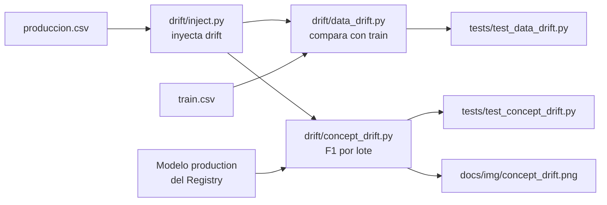
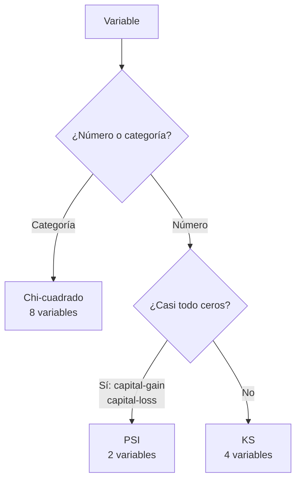
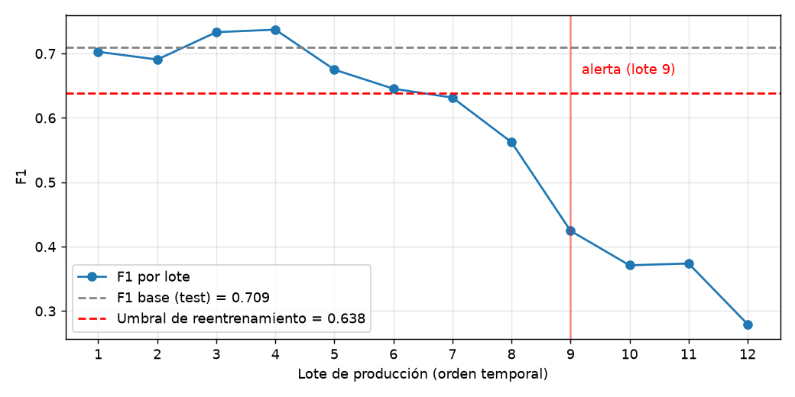

# Detección de drift (Paso 5)

El drift se detecta con código propio y se prueba con pytest: **verde** con datos limpios y **rojo** con datos derivados a propósito. Los datos "futuros" salen de `data/produccion.csv` (20 % del dataset, nunca vista en entrenamiento) y el baseline de referencia es `data/train.csv`.

| Archivo | Qué hace |
|---|---|
| `drift/inject.py` | Inyecta data drift (cambia las X) y concept drift (cambia la relación X→y, sin tocar las X) |
| `drift/data_drift.py` | Informe por variable: KS, PSI o chi-cuadrado, con umbral y veredicto |
| `drift/concept_drift.py` | Parte producción en lotes, calcula el F1 de cada uno y decide cuándo reentrenar |
| `tests/test_data_drift.py` | 15 pruebas: verde/rojo, 10 muestras sin falsas alarmas, variables no tocadas |
| `tests/test_concept_drift.py` | 5 pruebas: criterio de alerta, inyección y verde/rojo con el modelo real |

Ejecutar: `python -m drift.data_drift`, `python -m drift.concept_drift` y `pytest tests`. Las pruebas con modelo necesitan MLflow accesible (`kubectl port-forward service/mlflow 5000:5000`); sin él se omiten, no fallan.

## Variables del dataset

Adult Income (censo de EE. UU., 1994). Cada fila es una persona. Hay 14 variables de entrada (X) y una variable a predecir (y). Los porcentajes vienen de `train.csv` (29.305 filas).

**Variable a predecir:** `income`, 1 si la persona gana más de 50K al año y 0 si no. Solo el 23.9 % es 1.

### Numéricas (6)

| Variable | Qué es | Rango | Nota | Prueba de drift |
|---|---|---|---|---|
| `age` | Edad en años | 17 a 90 (mediana 37) | | KS |
| `fnlwgt` | Peso muestral del censo: cuántas personas de la población representa esa fila | 12.285 a 1.366.120 | No describe a la persona, es un factor técnico del censo | KS |
| `education-num` | Nivel educativo como número | 1 a 16 (mediana 10) | Es la misma información que `education`, en forma numérica | KS |
| `hours-per-week` | Horas trabajadas por semana | 1 a 99 (mediana 40) | Mucha gente trabaja exactamente 40 | KS |
| `capital-gain` | Ganancias de capital del año (inversiones, ventas) | 0 a 99.999 | **91.8 % son 0** | PSI |
| `capital-loss` | Pérdidas de capital del año | 0 a 4.356 | **95.3 % son 0** | PSI |

### Categóricas (8)

| Variable | Qué es | Categorías | Más frecuentes | Nulos | Prueba de drift |
|---|---|---|---|---|---|
| `workclass` | Tipo de empleador | 8 | Private 73 %, Self-emp-not-inc 8 %, Local-gov 7 % | 5.7 % | Chi-cuadrado |
| `education` | Nivel educativo en texto | 16 | HS-grad 33 %, Some-college 22 %, Bachelors 17 % | 0 % | Chi-cuadrado |
| `marital-status` | Estado civil | 7 | Married-civ-spouse 46 %, Never-married 33 %, Divorced 14 % | 0 % | Chi-cuadrado |
| `occupation` | Ocupación | 14 | Prof-specialty 14 %, Craft-repair 13 %, Exec-managerial 13 % | 5.7 % | Chi-cuadrado |
| `relationship` | Papel en el hogar | 6 | Husband 40 %, Not-in-family 26 %, Own-child 15 % | 0 % | Chi-cuadrado |
| `race` | Raza | 5 | White 86 %, Black 9 %, Asian-Pac-Islander 3 % | 0 % | Chi-cuadrado |
| `sex` | Sexo | 2 | Male 67 %, Female 33 % | 0 % | Chi-cuadrado |
| `native-country` | País de origen | 41 | United-States 91 %, Mexico 2 %, Philippines 1 % | 1.7 % | Chi-cuadrado |

Los nulos del original venían como `?` y se tratan como valores faltantes. En el drift, "faltante" cuenta como una categoría más: si de pronto faltaran muchos datos de `occupation`, el chi-cuadrado lo detectaría.

`sex`, `race` y `native-country` son variables sensibles. Se mantienen en el modelo (decisión en `crisp-dm.md`) y se vigilan igual que el resto.

### Por qué la prueba depende del tipo de variable

## Herramientas que usamos

| Herramienta | Para qué se usa | Dónde |
|---|---|---|
| **Python + pandas** | Cargar los CSV, partir producción en lotes, armar el informe por variable | `drift/*.py` |
| **SciPy** (`scipy.stats`) | `ks_2samp`: prueba KS de dos muestras. `chi2_contingency`: prueba chi-cuadrado | `drift/data_drift.py` |
| **NumPy** | Calcular los cajones y la fórmula del PSI (no hay una función lista en SciPy, se implementó a mano en `psi()`) | `drift/data_drift.py` |
| **scikit-learn** (`f1_score`) | Calcular el F1 del modelo en cada lote | `drift/concept_drift.py` |
| **MLflow** | Descargar el modelo con alias `production` del Registry para medir su F1 | `drift/concept_drift.py` |
| **Matplotlib** | Dibujar la gráfica de F1 por lote con el umbral | `docs/img/concept_drift.png` |
| **pytest** | Pruebas automáticas en verde y rojo | `tests/test_data_drift.py`, `tests/test_concept_drift.py` |

Las versiones están fijadas en `requirements.txt`.

**Qué se usa para cada tipo de drift:**
- Data drift: pandas + SciPy + NumPy. No hace falta modelo ni etiquetas.
- Concept drift: pandas + scikit-learn + MLflow + Matplotlib. Hace falta el modelo y las etiquetas reales.

**Por qué no usamos una librería de drift ya hecha** (por ejemplo Evidently): para este proyecto interesa poder explicar cada prueba y cada umbral, y con SciPy y NumPy son pocas líneas de código. Una librería lo daría hecho, pero ocultaría justo lo que hay que justificar. En un sistema de producción real sí sería razonable usar una.

## Data drift

Pregunta: ¿las X que llegan se parecen a las del entrenamiento? No necesita etiquetas, así que se puede vigilar en tiempo real.

| Tipo de variable | Prueba | Se marca drift si |
|---|---|---|
| Numéricas (`age`, `fnlwgt`, `education-num`, `hours-per-week`) | Kolmogorov-Smirnov | p < 0.01 / 12 |
| `capital-gain`, `capital-loss` | PSI (bin propio para el 0, deciles del resto) | PSI ≥ 0.2 |
| Categóricas (8) | Chi-cuadrado (categorías con < 0.5 % se agrupan en `other`) | p < 0.01 / 12 |

- **Por qué PSI en las variables de capital:** ~90 % de los valores son 0, y con tantos empates KS se comporta mal. PSI trata el cero como categoría propia.
- **Por qué dividir α entre 12:** son 12 pruebas con p-valor sobre la misma muestra. Sin corrección, con α = 0.01 cada una, la probabilidad de alguna falsa alarma en una muestra limpia sería de hasta ~11 %. Con Bonferroni baja a ~1 %.
- **PSI 0.2:** convención habitual (< 0.1 estable, 0.1–0.2 vigilar, ≥ 0.2 cambio relevante).
- **Veredicto del conjunto:** hay drift si al menos una variable lo tiene. Las variables sensibles (`sex`, `race`, `native-country`) se vigilan igual que las demás, como se decidió en `crisp-dm.md`.

### Resultado (2000 filas de producción contra train)

| Escenario | Variables con drift |
|---|---|
| Datos limpios | **0 / 14** (verde) |
| Datos derivados | **5 / 14** (rojo): `age`, `hours-per-week`, `capital-gain`, `workclass`, `sex` |

El drift inyectado fue: edad +8 años, −6 horas semanales, ganancias de capital más altas y más frecuentes, 30 % de `workclass` pasa a `Self-emp-not-inc` y 30 % de `sex` pasa a `Female`. Las otras 9 variables no se tocaron y ninguna se marcó.

## Concept drift

Pregunta: ¿la relación entre las X y el ingreso sigue siendo la misma? Aquí las X pueden verse normales y aun así el modelo falla, por eso hace falta medir el F1 con etiquetas reales.

**Simulación:** producción se parte en 12 lotes consecutivos (~814 filas). Desde el lote 5 cambian dos reglas del mundo y la intensidad sube hasta el lote 12: quienes tienen estudios superiores (`education-num ≥ 13`) dejan de ganar > 50K, y los menores de 30 con jornada larga (≥ 45 h) pasan a ganarlo. Las X no cambian.

**Criterio de reentrenamiento:** F1 del lote por debajo del **90 % del F1 base** (0.709 en test → umbral **0.638**) durante **3 lotes seguidos**.

- El 10 % sale del criterio de éxito de `crisp-dm.md`.
- Los 3 lotes seguidos evitan reentrenar por el ruido de un solo lote. Con datos limpios los lotes oscilan entre 0.64 y 0.74: uno llegó a 0.643, casi en el umbral, y sin la regla de la racha habría estado a un paso de una falsa alarma.

| Escenario | F1 por lote | Alerta |
|---|---|---|
| Limpio | entre 0.643 y 0.737, sin racha bajo el umbral | No (verde) |
| Con concept drift | 0.70, 0.69, 0.73, 0.74, 0.68, 0.65, 0.63, 0.56, **0.43**, 0.37, 0.37, 0.28 | **Sí, en el lote 9** (rojo) |

El F1 cruza el umbral en el lote 7, pero la alerta solo se confirma en el 9 por exigir 3 seguidos.

### Retraso de etiquetas

En el negocio real la etiqueta (si la persona realmente supera los 50K) tarda en conocerse: meses en el caso de ingresos. Esto limita el concept drift:

- La alerta llega con retraso: cuando se confirma, el modelo lleva semanas o meses degradado. Aquí hay un desfase de al menos 3 lotes más el tiempo de espera de etiquetas.
- Por eso el **data drift es la señal temprana** (no necesita etiquetas) y el **F1 por lotes es la confirmación**. Un data drift sin caída de F1 se vigila; un data drift con caída sostenida de F1 dispara el reentrenamiento.
- Si el retraso es largo, se puede evaluar con una muestra etiquetada de forma prioritaria, o con proxies (por ejemplo, la tasa de conversión de la campaña).
- En esta simulación las etiquetas están disponibles al instante: es la versión optimista.

### Qué hacer al saltar la alerta

Se vuelve a la fase 1 de CRISP-DM: revisar el objetivo, reentrenar con datos recientes (`train.train` y `train.register`), y mover el alias `production` a la versión nueva. Los pods la recogen con `kubectl rollout restart deployment/adult-api`, sin cambiar la imagen.

## Limitaciones

- El drift es **sintético**: los dos escenarios se diseñaron para ser detectables. En datos reales el cambio es más gradual y los umbrales habría que calibrarlos con historia real.
- El F1 por lote tiene ruido de ±0.03 con ~800 filas. Con lotes más pequeños, el criterio de 3 seguidos sería menos fiable.
