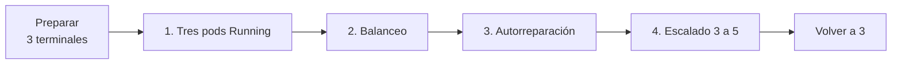

# Guía rápida: demo en vivo de Kubernetes

Cuatro demostraciones en unos 5 minutos: pods corriendo, balanceo, autorreparación y escalado. Todo en PowerShell, desde la carpeta del proyecto.



## Antes de empezar (hacerlo 10 minutos antes)

```powershell
minikube start
kubectl wait --for=condition=Ready pod -l app=mlflow --timeout=180s
kubectl rollout status deployment/adult-api
kubectl get pods        # mlflow 1/1 y tres adult-api 1/1
```

Si los pods de la API no pasan a `1/1`, ver "Si algo falla" al final.

## Las tres terminales

| Terminal | Para qué | Comando |
|---|---|---|
| A | Túnel a la API. **Dejar abierta.** | `minikube service adult-api --url` |
| B | Vigilar los pods en vivo | `kubectl get pods -l app=adult-api -w` |
| C | Ejecutar la demo | los comandos de abajo |

En la terminal A aparece una URL como `http://127.0.0.1:64096`. **El puerto cambia en cada ejecución.** Guardarla en la terminal C:

```powershell
$U = "http://127.0.0.1:64096"      # la que muestre la terminal A
$PY = ".venv\Scripts\python.exe"
$env:PYTHONUTF8 = "1"
```

## 1. Tres pods Running

```powershell
kubectl get pods -l app=adult-api
kubectl get deployment adult-api
```

Qué decir: el `Deployment` pide 3 réplicas y hay 3 pods `1/1 Running`.

## 2. Balanceo de carga

```powershell
& $PY k8s/probe.py $U 12
```

Resultado esperado: 12 peticiones, 0 errores, repartidas entre 3 nombres de pod distintos.

Qué decir: la respuesta incluye el campo `pod`; peticiones sucesivas las atienden pods distintos. El reparto puede no ser exactamente 4/4/4 (el túnel balancea por conexión). Con más peticiones se iguala.

## 3. Autorreparación

Mirar la terminal B mientras se ejecuta esto en C:

```powershell
$V = kubectl get pods -l app=adult-api -o jsonpath='{.items[0].metadata.name}'
kubectl delete pod $V --wait=false
& $PY k8s/probe.py $U 30
kubectl get pods -l app=adult-api
```

Resultado esperado: en B se ve un pod `Terminating` y otro nuevo pasar por `Pending`, `ContainerCreating` y `Running`. Las 30 peticiones salen con **0 errores**. Al final hay otra vez 3 pods `1/1`, uno de ellos con edad de segundos.

Qué decir: el Deployment mantiene el número de réplicas deseado, así que recrea el pod. Mientras tanto el Service solo envía tráfico a pods listos (`readinessProbe`), por eso el cliente no nota nada. El pod nuevo carga el modelo desde MLflow por alias.

## 4. Escalado

```powershell
kubectl scale deployment/adult-api --replicas=5
kubectl rollout status deployment/adult-api
kubectl get pods -l app=adult-api
& $PY k8s/probe.py $U 50
```

Resultado esperado: 5 pods `1/1 Running` en unos 20 segundos, y las 50 peticiones repartidas entre 5 nombres de pod.

Qué decir: un solo comando cambia el número de réplicas y Kubernetes crea los pods nuevos; el Service los incorpora cuando están listos.

Dejarlo como estaba:

```powershell
kubectl scale deployment/adult-api --replicas=3
kubectl get pods -l app=adult-api
```

## Si algo falla

| Síntoma | Causa probable | Qué hacer |
|---|---|---|
| `kubectl` no conecta con `localhost:8080` | minikube parado | `minikube start` |
| Pods de la API en `0/1` o reiniciando | MLflow aún no está listo, o el Registry está vacío | `kubectl get pods`; esperar a MLflow `1/1`. Si el Registry está vacío, ver "Cómo retomar" en `estado.md` |
| `probe.py` da todo errores | URL del túnel equivocada o terminal A cerrada | Reabrir `minikube service adult-api --url` y actualizar `$U` |
| El pod nuevo tarda en estar `1/1` | Carga el modelo al arrancar (hasta 2 min de margen) | Esperar; `kubectl logs <pod>` si no avanza |
| Reparto muy desigual | El túnel balancea por conexión | Subir las peticiones, p. ej. `probe.py $U 100` |

## Evidencia de referencia

Salidas reales de una ejecución previa: [autorreparación](evidencia-autorreparacion.txt) y [escalado](evidencia-escalado.txt).
