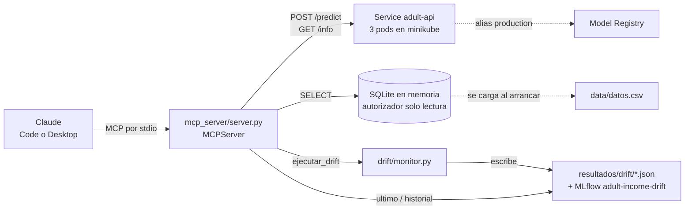

# Servidor MCP (extra)

Servidor MCP (`mcp_server/`) que permite a un asistente (Claude Code o Claude Desktop) hacer tres cosas: **pedir predicciones al modelo desplegado en Kubernetes**, **consultar el dataset con SQL de solo lectura** y **ejecutar y consultar el monitor de drift**. No está en las instrucciones; es un extra sobre el caso de negocio de `crisp-dm.md`.



## Herramientas, recursos y prompt

| Tipo | Nombre | Qué hace |
|---|---|---|
| Tool | `predecir_prospecto` | Las variables del prospecto como parámetros con valores cerrados. Devuelve predicción, probabilidad de >50K, prioridad Alta/Media/Baja, acción, versión del modelo y pod |
| Tool | `priorizar_campana` | Hasta 500 prospectos y un % de presupuesto (10 por defecto): ranking e indica a quién contactar |
| Tool | `info_modelo` | Modelo, alias, versión, run y pod (`GET /info`) |
| Tool | `consultar_datos` | `SELECT` sobre la tabla `datos` y las vistas `train`, `test` y `llegadas`, máximo 200 filas |
| Tool | `describir_datos` | Tablas, columnas, filas y proporción de >50K |
| Tool | `ejecutar_drift` | **Escribe.** Ejecuta el monitor sobre el dump hasta un periodo (entero de 0 a 12) y guarda el resultado en `resultados/drift/` y en MLflow. Devuelve veredicto y tabla por lote |
| Tool | `ultimo_resultado_drift` | Lee el último resultado guardado: lotes en rojo, alerta y con qué dump se calculó |
| Tool | `historial_drift` | Lista las ejecuciones guardadas, la más reciente primero |
| Resource | `datos://esquema`, `datos://{tabla}/muestra` | Contexto para saber qué consultar |
| Resource | `drift://ultimo` | El JSON del último resultado de drift |
| Prompt | `priorizar_prospectos` | Guía el flujo: describir, explorar, evaluar y resumir con las advertencias |

La prioridad y el armado del JSON reutilizan `ui/perfiles.py`, así que el servidor y la interfaz Streamlit dan siempre el mismo resultado.

## Tablas

| Tabla / vista | Contenido |
|---|---|
| `datos` | El dump completo (48.842 filas), con las columnas `periodo` (0 a 12) y `particion` (`train`, `test`, `llegada`). Ver [`datos.md`](datos.md) |
| `train`, `test` | Vistas: la base (periodo 0) con su partición original |
| `llegadas` | Vista: lotes 1 a 12, con la columna `periodo`. **Simulada**: data drift en los periodos 3-4 y concept drift desde el 5 |

`income`: 1 = >50K. Las llegadas son datos simulados, no independientes. Las columnas con guion (`hours-per-week`) se entrecomillan en SQL: `"hours-per-week"`. La base de datos se carga una sola vez al arrancar el servidor, con el `datos.csv` que haya en disco en ese momento (si cambias de etiqueta de datos, reinicia el servidor).

## Cómo registrarlo

```powershell
pip install -r mcp_server/requirements-mcp.txt
minikube service adult-api --url           # dejar abierta; copiar la URL
```

`.mcp.json` (en la raíz del repositorio) lo registra en Claude Code. Hay que poner en `API_URL` la URL que imprimió minikube, porque el puerto cambia en cada ejecución:

```json
{ "mcpServers": { "adult-income": {
    "command": ".venv/Scripts/python.exe", "args": ["-m", "mcp_server.server"],
    "env": { "API_URL": "http://127.0.0.1:<puerto>" } } } }
```

Variables: `API_URL` (por defecto `http://localhost:8080`) y `DATA_DIR` (por defecto `data/`). Sin API, `consultar_datos` y `describir_datos` siguen funcionando y las de predicción devuelven un error con la causa.

## Ejemplos para pedirle a Claude

- "¿Qué proporción gana >50K por nivel educativo en `test`?"
- "Compara la proporción de >50K de `llegadas` por periodo."
- "Ejecuta el monitor de drift hasta el periodo 4 y dime qué variables salieron en rojo."
- "¿Cuál es el último resultado de drift? ¿Con qué dump se calculó?"
- "Evalúa a una mujer de 24 años con licenciatura que trabaja 40 horas en soporte técnico."
- "Toma 200 filas de `test` con `income = 1` y dime cuántas acierta el modelo."

## Seguridad

| Riesgo | Medida |
|---|---|
| Consultas que escriben o adjuntan archivos | Un autorizador de SQLite deniega todo salvo `SELECT`, lecturas y una lista blanca de funciones; `PRAGMA`, `ATTACH` y `load_extension` quedan denegados. Además, una sola sentencia que empiece por `SELECT` o `WITH` |
| Respuestas enormes | Límite de 200 filas, con aviso de truncado |
| Una herramienta que escribe | `ejecutar_drift` solo recibe un entero de 0 a 12 (no rutas), escribe únicamente en `resultados/drift/` y en MLflow, y su descripción avisa que escribe. Las demás de drift solo leen |
| Llamar a direcciones arbitrarias | `API_URL` es una variable de entorno, no un parámetro de las herramientas |
| Valores inválidos | Las categóricas tienen opciones cerradas; se validan antes de llamar a la API |
| Datos sensibles | Los datos son públicos y de 1994. Las consultas pasan por el modelo de lenguaje, así que no se debería apuntar este servidor a datos reales de clientes sin revisarlo |
| Variables sensibles (`sex`, `race`, `native-country`) | El modelo las usa (limitación de `crisp-dm.md`). La descripción de la herramienta y el prompt lo recuerdan: es una guía, no una decisión automática |

## Qué se comprobó

- `tests/test_mcp.py` (17 pruebas): consultas válidas, límite de filas, 10 consultas peligrosas rechazadas (incluido `DROP VIEW`), prioridad con API simulada, una prueba extremo a extremo con el cliente MCP en memoria y otra de las herramientas de drift (escribe solo en un directorio temporal).
- En vivo, por stdio y contra la API real del clúster: `info_modelo` (v2, pod real), `predecir_prospecto` (Ejecutivo: 86 %, prioridad Alta) y una consulta por nivel educativo sobre `test`. `readfile(...)` fue rechazada con un mensaje claro.
- El monitor se ejecutó en vivo contra la API del clúster (`python -m drift.monitor`: alerta en el lote 9).
- Falta probarlo conversando desde Claude Code con el `.mcp.json` (requiere reiniciar la sesión y aprobar el servidor).
