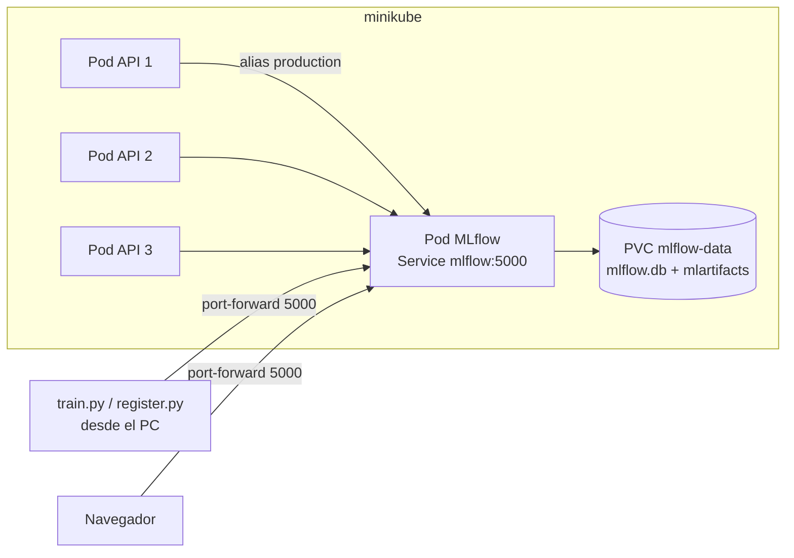

# Servidor MLflow en Kubernetes

MLflow corre como un pod dentro de minikube, con un volumen persistente. Es el único componente que toca el disco: entrenamiento y API usan HTTP.



## Archivos

| Archivo | Qué es |
|---|---|
| `docker/Dockerfile.mlflow` | Imagen propia: Python 3.13 + `mlflow==3.17.2` |
| `k8s/mlflow.yaml` | PVC (2 GiB), Deployment (1 réplica, estrategia `Recreate`) y Service |

`Recreate` evita dos pods escribiendo a la vez en SQLite.

## Comandos

```powershell
docker build -f docker/Dockerfile.mlflow -t adult-mlflow:1.2 .
minikube image load adult-mlflow:1.2
kubectl apply -f k8s/mlflow.yaml
kubectl port-forward service/mlflow 5000:5000     # deja esta terminal abierta
```

Interfaz: http://localhost:5000. Entrenar y registrar (en otra terminal, con `PYTHONUTF8=1`):

```bash
python -m train.train
python -m train.register
```

Las decisiones y problemas de este montaje están en [`desviaciones.md`](desviaciones.md), entradas 10 a 14.
