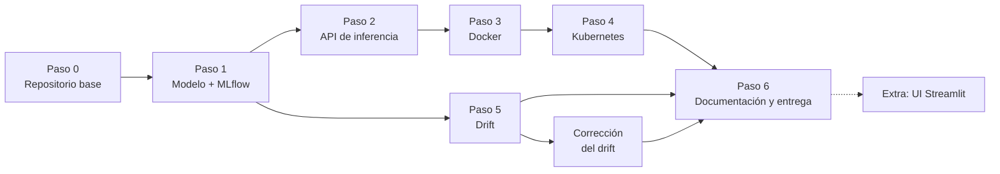
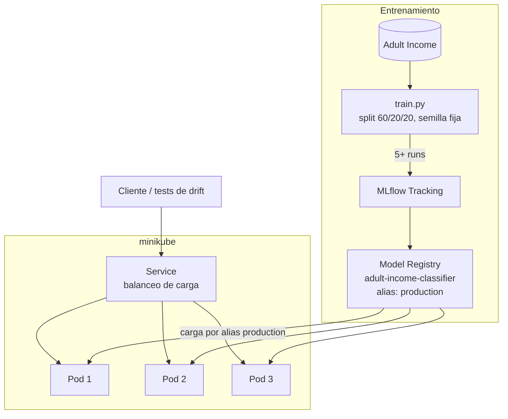
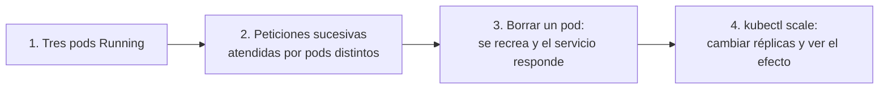

# Plan de avance — Proyecto final MLOps

Proyecto individual. Dataset: **Adult Income** (censo EE. UU. 1994, clasificación binaria `>50K` / `<=50K`). Clúster: **minikube** sobre Docker Desktop.

## Ruta general



## Arquitectura objetivo



## Pasos

| Paso | Qué se hace | Entregable |
|---|---|---|
| 0 | Git, estructura de carpetas, `requirements.txt` con versiones fijas | Repositorio con primer commit |
| 1 | Entrenar con 5+ runs en MLflow, registrar 2+ versiones, alias `production` | UI de MLflow con runs comparables |
| 2 | API FastAPI: `/predict` (devuelve el nombre del pod) y `/health`; carga el modelo por alias | API local funcionando |
| 3 | `Dockerfile` propio con dependencias fijas (incluida la versión de MLflow) | Imagen que responde con `docker run` |
| 4 | `Deployment` (3 réplicas) y `Service` en minikube; 4 demostraciones con evidencia | Capturas / logs de terminal |
| 5 | Pruebas de data drift y concept drift con pytest | Tests verde/rojo y gráfica de degradación |
| 6 | Documento de arquitectura, tabla de reparto, ZIP de evidencias | Entrega final |

## Demostraciones de Kubernetes (Paso 4)



## Estructura del repositorio

```
proyecto-final/
├── configs/     # configuración del experimento (YAML)
├── train/       # entrenamiento y registro en MLflow
├── serving/     # API de inferencia
├── docker/      # Dockerfiles y dependencias de las imágenes
├── k8s/         # manifiestos de Kubernetes
├── drift/       # inyección y detección de drift
├── tests/       # pruebas automatizadas
├── ui/          # interfaz Streamlit (extra)
├── data/        # datos versionados con DVC
├── entrega/     # script del ZIP de entrega
├── .github/     # CI con GitHub Actions
└── docs/        # plan, arquitectura y evidencias
```
