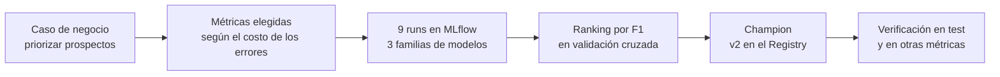
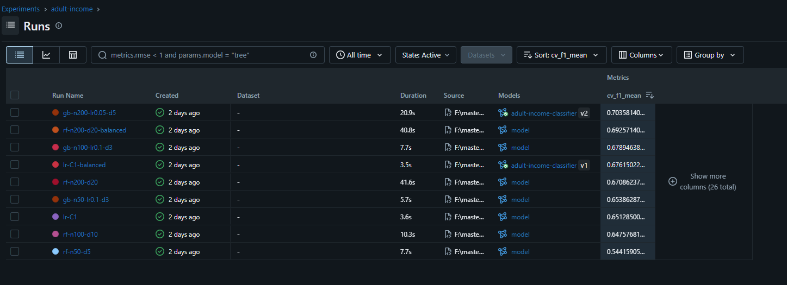
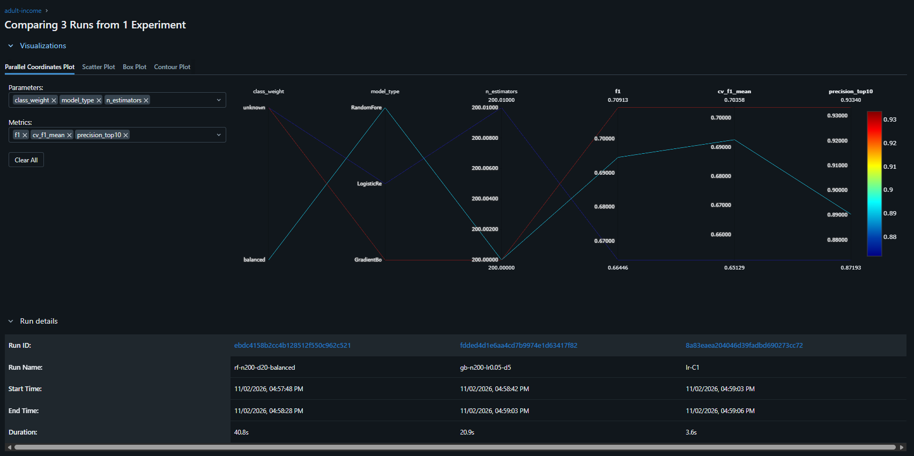
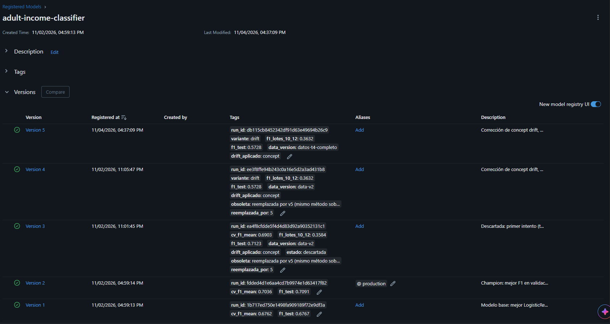

# Selección del modelo Champion

Este documento responde tres preguntas, en este orden: **qué métricas usamos y por qué**, **qué modelos comparamos y por qué**, y **cuál es el Champion y cómo se defiende**.

## 1. Métricas: qué medimos y por qué

El escenario (ver `crisp-dm.md`): una entidad financiera prioriza a quién contactar para un producto premium. Solo ~24 % de la gente gana `>50K`.

| Métrica | Qué responde | Por qué la usamos |
|---|---|---|
| **F1** | ¿Qué tan bien equilibra encontrar a los buenos prospectos y no molestar a los que no lo son? | **Métrica principal.** Resiste el desbalance y resume precisión y recall en un solo número, fácil de graficar en el tiempo (drift) |
| **Precision** | De los que el modelo marca como `>50K`, ¿cuántos lo son de verdad? | Mide el desperdicio de campaña (falsos positivos) |
| **Recall** | De todos los que sí son `>50K`, ¿cuántos encontramos? | Mide las ventas perdidas (falsos negativos) |
| **ROC-AUC** | ¿Ordena bien a los prospectos, de más a menos probable? | No depende del umbral de 0.5. Mide la calidad del ranking |
| **Precision@10 %** | Si contactamos solo al 10 % mejor puntuado, ¿cuántos aciertan? | Refleja una campaña con presupuesto limitado |
| **Accuracy** | ¿Qué porcentaje acierta en total? | Solo informativa: un modelo que siempre dice `<=50K` ya obtiene ~76 % |
| **CV F1 (media y desviación)** | ¿El F1 se sostiene en 5 particiones distintas de train? | **Criterio de selección.** Evita elegir por suerte de un solo split y deja test intacto |

### Por qué F1 y no otra
Los dos errores cuestan, pero distinto: contactar a alguien que no califica cuesta poco; perder una venta cuesta más. F1 los pondera igual, así que es un **compromiso razonable, no un óptimo**. Si el negocio confirmara que perder una venta cuesta mucho más, convendría priorizar el recall (o ajustar el umbral). Esa relación de costos es un **supuesto** pendiente de validar con el negocio.

### Por qué seleccionar con validación cruzada y no con test
Si elegimos el modelo mirando el F1 de test, ese número queda ligeramente optimista, porque el modelo "ganó" justo en esos datos. Por eso:
- **Elegir** con `cv_f1_mean` (solo datos de train).
- **Reportar** con test, que no participó en la decisión.

## 2. Modelos: qué comparamos y por qué

| Familia | Por qué está |
|---|---|
| **Regresión logística** | Línea base simple e **interpretable**: se puede explicar qué peso tiene cada variable. En finanzas la explicabilidad pesa |
| **RandomForest** | Árboles independientes que votan. Robusto y con pocos ajustes |
| **GradientBoosting** | Árboles en cadena que corrigen errores. Suele ser el mejor en datos tabulares |

Además se probó `class_weight="balanced"` (en regresión logística y RandomForest) para ver el efecto del desbalance de clases. GradientBoosting no tiene esa opción.

## 3. Resultados (9 runs, ordenados por CV F1)

| Run | CV F1 (± desv.) | F1 test | Precision | Recall | AUC | P@10 % | Accuracy |
|---|---|---|---|---|---|---|---|
| **gb-n200-lr0.05-d5** | **0.704 ± 0.005** | **0.709** | 0.783 | 0.648 | **0.928** | **0.933** | **0.873** |
| rf-n200-d20-balanced | 0.693 ± 0.005 | 0.695 | 0.586 | 0.853 | 0.915 | 0.890 | 0.821 |
| gb-n100-lr0.1-d3 | 0.679 ± 0.010 | 0.689 | 0.802 | 0.603 | 0.922 | 0.931 | 0.870 |
| lr-C1-balanced | 0.676 ± 0.008 | 0.677 | 0.563 | 0.848 | 0.907 | 0.861 | 0.806 |
| rf-n200-d20 | 0.671 ± 0.012 | 0.676 | 0.774 | 0.599 | 0.916 | 0.915 | 0.862 |
| gb-n50-lr0.1-d3 | 0.654 ± 0.010 | 0.662 | 0.801 | 0.563 | 0.916 | 0.920 | 0.862 |
| lr-C1 | 0.651 ± 0.012 | 0.665 | 0.742 | 0.602 | 0.907 | 0.872 | 0.855 |
| rf-n100-d10 | 0.648 ± 0.016 | 0.653 | 0.794 | 0.555 | 0.911 | 0.913 | 0.859 |
| rf-n50-d5 | 0.544 ± 0.021 | 0.571 | 0.801 | 0.444 | 0.896 | 0.860 | 0.841 |

### Qué se observa
1. **Más capacidad, mejor resultado.** `rf-n50-d5` es demasiado simple (CV F1 0.544); al subir árboles y profundidad mejora. Es *underfitting* corregido.
2. **El desbalance se puede compensar, con un costo.** Las variantes `balanced` suben el recall a ~0.85, pero la precision cae a ~0.57 y la accuracy a ~0.81. Encuentran más buenos prospectos a cambio de contactar a mucha gente que no califica.
3. **La regresión logística queda a ~5 puntos de F1 del mejor** (0.651 contra 0.704 en CV), un precio razonable por la explicabilidad.
4. **CV y test coinciden** (0.704 contra 0.709 para el Champion). Es señal de que la selección no se sobreajustó a test.

## 4. El Champion

| | |
|---|---|
| **Modelo** | GradientBoosting, 200 árboles, `learning_rate=0.05`, `max_depth=5` |
| **Run** | `gb-n200-lr0.05-d5` (`fdded4d1e6aa4cd7b9974e1d63417f82`) |
| **Registry** | `adult-income-classifier`, **versión 2**, alias `production` |
| **Modelo base (v1)** | `lr-C1-balanced` (`1b717ed750e1498fa909189f72e9df3a`) |

### Capturas de MLflow

Los 9 runs ordenados por `cv_f1_mean`:

Comparación de tres runs (`gb-n200-lr0.05-d5`, `rf-n200-d20-balanced` y `lr-C1`) con `model_type`, `n_estimators`, `class_weight`, `cv_f1_mean`, `f1` y `precision_top10`:

Model Registry: la v2 con el alias `production`, y las v3 a v5 (intentos de corregir el drift; la v3 y la v4 marcadas como obsoletas):

### Por qué este y no otro
- **Mejor CV F1 (0.704)** y la **menor variabilidad** entre particiones (± 0.005): es el más estable.
- **Mejor AUC, Precision@10 % y accuracy.** No gana por una métrica aislada, gana en casi todas.
- **El F1 de test lo confirma** (0.709).

### Límites que hay que reconocer
- **La ventaja sobre el segundo es pequeña** (0.704 contra 0.693 en CV; la variabilidad entre particiones ronda 0.005). Es consistente, pero no abrumadora.
- **Si el negocio prioriza el recall**, `rf-n200-d20-balanced` (recall 0.853) sería una alternativa válida. Una opción mejor sería mantener el Champion y bajar su umbral de decisión, que no requiere otro modelo.
- **No es explicable por variable** como la regresión logística. Si el área de riesgo lo exigiera, v1 es el plan B.
- **Los datos son de 1994**; el rendimiento absoluto no se traslada a hoy.
- **Se mantienen `sex`, `race` y `native-country`** (decisión documentada en `crisp-dm.md`).

### Respuesta corta para la defensa
> Elegimos GradientBoosting porque fue el mejor en F1 con validación cruzada y también en AUC y precisión del top 10 %, con la menor variabilidad. Lo seleccionamos sin mirar test, y test confirmó el resultado. La regresión logística queda como modelo base explicable, a unos 5 puntos de F1.
