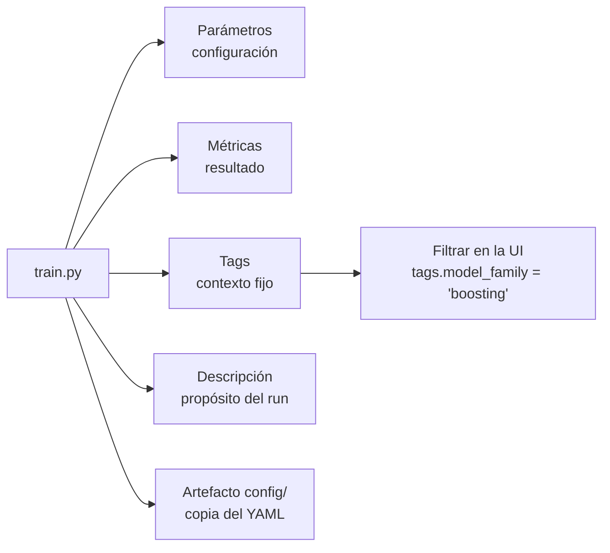

# Tags, descripción y configuración de los runs

Cada run guarda varios tipos de información, con un propósito distinto:

| Tipo | Responde | Ejemplo |
|---|---|---|
| **Parámetros** | ¿Cómo lo configuré? | `n_estimators=200`, `max_depth=5` |
| **Métricas** | ¿Qué resultado obtuvo? | `f1`, `cv_f1_mean` |
| **Tags** | ¿Qué contexto necesito para entenderlo y filtrarlo? | `model_family=boosting` |
| **Descripción** | ¿Por qué existe este run y qué se quería averiguar? | "Aísla el efecto del desbalance de clases" |
| **Configuración** | ¿Con qué archivo exacto se definió? | `config/experiments.yaml` (artefacto) |



## Regla de diseño

> Un tag es un **hecho fijo del momento del entrenamiento**. Se escribe una vez y nunca cambia.

Así no requiere mantenimiento. Los datos que cambian con el tiempo (qué versión está desplegada) viven **solo** en el Model Registry, para no tener dos fuentes de verdad.

## Los 5 tags

| Tag | Qué refleja | Valores | Cómo se obtiene |
|---|---|---|---|
| `model_family` | Familia del algoritmo | `linear`, `bagging`, `boosting` | Campo `family` de cada run en `configs/experiments.yaml` |
| `uses_class_weight` | Si el run compensa el desbalance de clases | `true` / `false` | `true` si los hiperparámetros incluyen `class_weight` |
| `data_hash` | Huella del conjunto de **train** usado | 12 caracteres hexadecimales | SHA-256 del contenido del DataFrame de train, cortado a 12 caracteres |
| `sklearn_version` | Versión de scikit-learn con la que se entrenó | por ejemplo `1.9.1` | `sklearn.__version__` |
| `selection_metric` | Métrica con la que se elige el Champion | `cv_f1_mean` | `global.selection_metric` del YAML, la misma que lee `register.py` |

## Para qué sirve cada uno

- **`model_family`:** comparar familias de un vistazo. Es más legible que el nombre de la clase.
- **`uses_class_weight`:** separar los runs que compensan el desbalance. Esos suben el recall y bajan la precision (ver [`seleccion-modelo.md`](seleccion-modelo.md)).
- **`data_hash`:** demostrar que todos los runs compararon con **los mismos datos**. Si dos runs tienen hash distinto, no son comparables. Una respuesta directa a "¿cómo sabes que la comparación es justa?".
- **`sklearn_version`:** el modelo está serializado con cloudpickle y debe cargarse con la misma versión en la API. Si una carga falla, es lo primero que se revisa.
- **`selection_metric`:** deja escrito en cada run con qué criterio se elige, para que nadie lo ordene por otra métrica y llegue a otra conclusión.

## Cómo usarlos en la interfaz

En la tabla de runs, el cuadro de búsqueda acepta filtros como:

```
tags.model_family = "boosting"
tags.uses_class_weight = "true"
tags.model_family = "boosting" and metrics.cv_f1_mean > 0.68
```

## Tags que MLflow ya añade solo

No se duplican: `mlflow.user` (quién entrenó), `mlflow.source.name` (script) y `mlflow.source.git.commit` (commit de Git).

## Decisiones: tags descartados

**`role`** (`champion` / `baseline`). Obligaría a actualizarlo cada vez que cambie el alias `production` y, si se olvidara, mostraría un Champion equivocado. El estado de despliegue lo dice el **alias del Model Registry**, que es la única fuente de verdad.

**`git_dirty`** (si había cambios sin commitear). Se descartó por innecesario: MLflow ya registra el commit de Git, y para el alcance del proyecto no aportaba lo suficiente como para mantener un tag más.

**`dataset`** (origen de los datos). Se descartó por redundante: todos los runs están en el mismo experimento (`adult-income`), que ya los agrupa por dataset, y `data_hash` demuestra que los datos son los mismos.

Para recorrer la trazabilidad se usan los tags de la **versión registrada**, que `register.py` fija una sola vez porque describen de dónde salió esa versión: `run_id`, `cv_f1_mean` y `f1_test`.

## Descripción del run

El campo **Description** de la interfaz es texto libre en Markdown. Se guarda en el tag de sistema `mlflow.note.content`. Cada run explica **por qué existe y qué pregunta responde**, por ejemplo:

> *rf-n200-d20-balanced:* Misma configuración que rf-n200-d20, pero con `class_weight="balanced"`. Aísla el efecto del desbalance de clases.

Qué entra y qué no, con el mismo criterio de los tags:
- **Sí:** el propósito del run, que es un hecho del momento en que se diseñó el experimento.
- **No:** resultados ni si es el Champion. Los resultados ya están en las métricas y el estado de despliegue vive en el Registry.

Las dos parejas `rf-n200-d20` / `rf-n200-d20-balanced` y `lr-C1` / `lr-C1-balanced` son experimentos controlados (cambian una sola cosa), y las descripciones lo dejan escrito.

El texto viene de `configs/experiments.yaml`. La interfaz permite editarlo a mano (por ejemplo, para añadir notas durante la defensa), pero esa edición no vuelve al YAML.

## Configuración como artefacto

Cada run guarda una copia de `configs/experiments.yaml` en `config/`. Así el run lleva consigo la configuración exacta que lo produjo, aunque el archivo cambie después. Detalle del archivo en [`configuracion.md`](configuracion.md).

## Limitaciones

- `data_hash` cubre solo el conjunto de train. El de test es el mismo en todos los runs por la semilla fija, pero no se registra su huella.
- El hash depende de cómo pandas representa los datos, así que puede cambiar si cambia la versión de pandas. Con las versiones fijadas en `requirements.txt` es estable.
