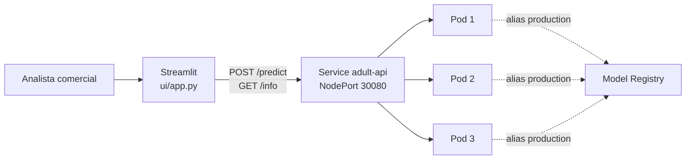

# Interfaz de priorización de prospectos (extra)

Aplicación Streamlit (`ui/app.py`) que consume la **API desplegada en Kubernetes**, no un proceso local. Responde a la pregunta de negocio de `crisp-dm.md`: *¿a quién contactar primero para el producto premium?*



## Cómo arrancarla

```powershell
pip install -r ui/requirements-ui.txt
minikube service adult-api --url        # imprime la URL; dejar la terminal abierta
$env:API_URL = "http://127.0.0.1:<puerto>"
streamlit run ui/app.py                  # http://localhost:8501
```

La URL también se puede cambiar desde la barra lateral. Si la API no responde, la interfaz lo avisa y deshabilita los botones de evaluar.

## Qué ofrece

**Pestaña "Un prospecto"**

| Atajo | Qué hace |
|---|---|
| 6 perfiles (Ejecutivo, Profesional con inversiones, Recién graduada, Oficio estable, Joven medio tiempo, Jubilada) | Rellena el formulario completo con un clic. Son puntos de partida para la demo, no personas reales |
| 🎲 Prospecto real al azar / que gana >50K / que gana ≤50K | Carga una fila de `data/test.csv` y, tras evaluar, compara la predicción con el ingreso real |
| 🧹 Limpiar | Vuelve a los valores base |

- `education-num` no se pide: se deduce de `education`.
- `fnlwgt` está en "Avanzado" con la mediana, porque no tiene sentido para un prospecto real.
- Tres variables aceptan "(desconocido)" y se envían como `null`, igual que los datos reales.

**Pestaña "Campaña (lote)"** (el caso de negocio)

Puntúa 50 a 2.000 prospectos, ya sea una muestra de `test.csv` o un CSV subido, y marca a quién contactar según el presupuesto (por defecto el mejor 10 %, la campaña de referencia del proyecto). Si el CSV trae la columna `income`, muestra cuántos del grupo contactado ganan realmente más de 50K frente a la lista completa. Permite descargar la lista priorizada.

**Barra lateral**

Muestra la versión del modelo, su alias y el run (de `GET /info`), y cuenta **qué pod respondió cada consulta**. Es otra forma de ver el balanceo de carga durante la demo.

## Prioridad comercial

| Probabilidad de >50K | Prioridad | Acción sugerida |
|---|---|---|
| ≥ 0,70 | Alta | Contactar primero |
| 0,40 a 0,70 | Media | Contactar si el presupuesto lo permite |
| < 0,40 | Baja | No priorizar |

**Supuesto:** estos umbrales son de la interfaz, no del modelo (que clasifica con 0,5). Habría que calibrarlos con el costo real de la campaña. Es una guía para priorizar, no una decisión automática, como se declaró en el caso de negocio.

## Sobre las variables sensibles

El formulario incluye `sex`, `race` y `native-country` porque el modelo las usa (decisión y limitación en `crisp-dm.md`). En un producto real, mostrarlas como campos de entrada para decidir a quién se ofrece un servicio habría que revisarlo con el área legal.

## Qué se comprobó

- Contra la API real del clúster, con los 3 pods respondiendo (se vio una consulta atendida por cada uno).
- Los 6 perfiles dieron prioridad Alta (Ejecutivo 86 %, Profesional con inversiones 99 %) o Baja (los otros cuatro, de 0,4 % a 28 %). Un prospecto real de >50K y otro de ≤50K se clasificaron bien.
- Una campaña de 500 prospectos: el 10 % contactado (50) tuvo un 98 % de acierto.
- `tests/test_ui.py`: los perfiles son válidos, el armado del JSON, las prioridades y que la app arranque y avise cuando no hay API.

Es una comprobación puntual de que la interfaz funciona, no una evaluación del modelo.
